<p align="center">
  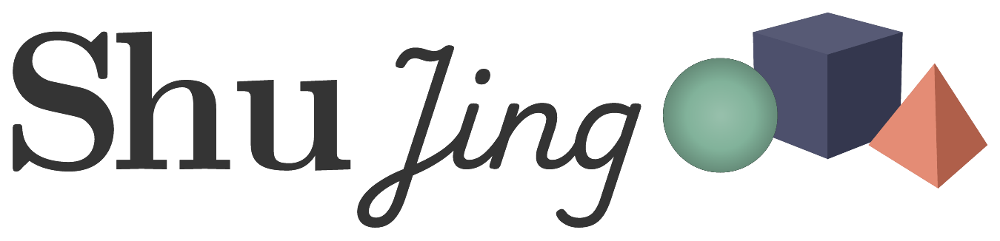
</p>

<p align="center">
  <b>极速 3D 数学动画引擎，兼容 <a href="https://www.manim.community">Manim Community Edition</a> API。</b><br>
  由 Rust 和 wgpu 驱动，GPU 加速渲染。一行 pip 安装，浏览器中亦可运行。
</p>

<p align="center">
  <b><a href="https://shujing.aipaikj.top">文档</a></b> ·
  <a href="https://shujing.aipaikj.top/user-guide/quickstart/">快速开始</a> ·
  <a href="https://shujing.aipaikj.top/gallery/">示例画廊</a> ·
  <a href="https://shujing.aipaikj.top/reference/">API 参考</a>
</p>

<p align="center">
  <a href="https://pypi.org/project/manimgx/"></a>
  <a href="https://www.npmjs.com/package/manimgx"></a>
  <a href="https://pepy.tech/projects/manimgx"></a>
  <a href="https://github.com/1Cyrvox/ShuJing/blob/main/LICENSE"></a>
</p>

<p align="center">
  <a href="https://gitee.com/feifu/ShuJing/blob/main/examples/quadratic_formula.py">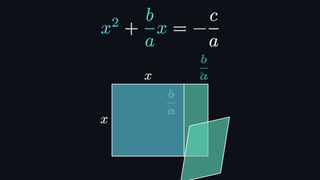</a>
  <a href="https://gitee.com/feifu/ShuJing/blob/main/examples/fourier_pi.py">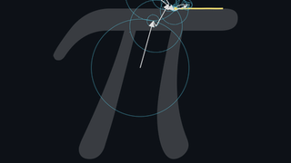</a>
  <a href="https://gitee.com/feifu/ShuJing/blob/main/examples/linear_maps.py">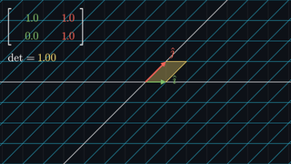</a>
  <br>
  <a href="https://gitee.com/feifu/ShuJing/blob/main/examples/derivative.py">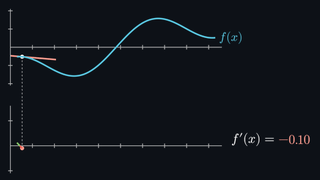</a>
  <a href="https://gitee.com/feifu/ShuJing/blob/main/examples/complex_maps.py">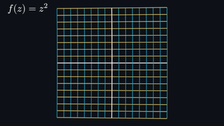</a>
  <a href="https://gitee.com/feifu/ShuJing/blob/main/examples/lorenz_attractor.py">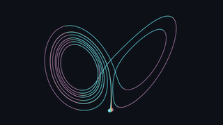</a>
  <br>
  <a href="https://gitee.com/feifu/ShuJing/blob/main/examples/heavy_top.py">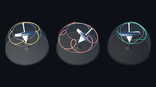</a>
  <a href="https://gitee.com/feifu/ShuJing/blob/main/examples/hopf_fibration.py">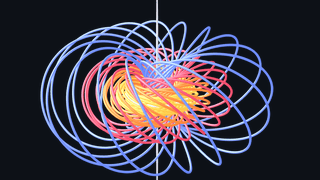</a>
  <a href="https://gitee.com/feifu/ShuJing/blob/main/examples/catenoid_helicoid.py">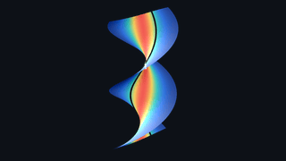</a>
</p>

---

## 性能

**36.2 秒的视频，仅需 3.08 秒渲染。** 在 Apple M4 Pro 上以 1080p60 渲染五个场景，数境（基于 ManimGX 引擎）比 **ManimCE 快 90.6 倍**，比 **ManimGL 快 11.5 倍**，比 **Blender Workbench 快 18.7 倍**（从启动到生成 MP4）。[测量方法](https://gitee.com/feifu/ShuJing/tree/main/benchmarks)。

<figure class="mx-benchmark">
  <picture>
    <source media="(prefers-color-scheme: dark)" srcset="shujing/zensite2/content/images/benchmark-dark.svg">
    <source media="(prefers-color-scheme: light)" srcset="shujing/zensite2/content/images/benchmark-light.svg">
    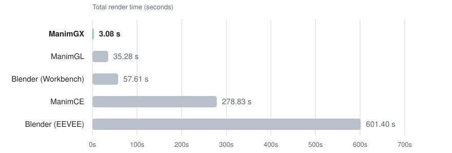
  </picture>
  <p align="center"><sub>所有引擎使用最快编码预设，越低越好。</sub></p>
</figure>

**同一场景对比。** 2.5 秒处的八个相连圆环，由各引擎分别渲染：

| 数境 / ManimGX | ManimCE | ManimGL | Blender Workbench | Blender EEVEE |
| :---: | :---: | :---: | :---: | :---: |
| 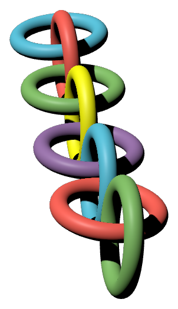 | 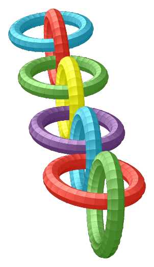 | 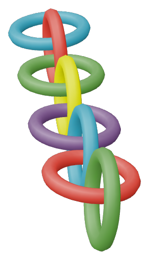 | 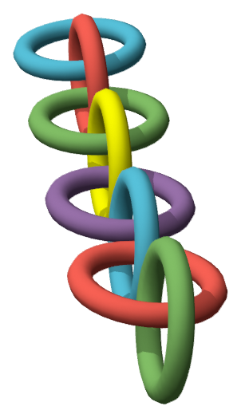 | 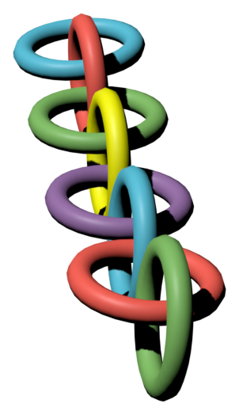 |

---

## 快速开始

**用 pip 安装**（需要 Python 3.13+）：

```sh
pip install manimgx
```

字体、排版和视频编码已全部内置，无需额外配置。编辑器配置与引导式首次动画请见[快速开始](https://shujing.aipaikj.top/user-guide/quickstart/)。

**用 AI 助手。** 粘贴到 Claude Code、Codex 或 Cursor 中，AI 助手自动完成安装：

```text
Follow https://shujing.aipaikj.top/llms.txt.
安装数境，制作一个太阳系 3D 动画并打开。
```

---

## 从 Python 到 MP4

将以下代码保存为 `scene.py`：

```python
import manimgx as m


class Hello3D(m.ThreeDScene):
    def construct(self) -> None:
        self.set_camera_orientation(phi=65 * m.DEGREES, theta=-45 * m.DEGREES)
        self.begin_ambient_camera_rotation(rate=0.5)
        cube = m.Cube(side_length=3, fill_opacity=0.3, stroke_width=2)
        self.play(m.Create(cube), run_time=2)
        self.wait(4)
```

渲染：

```sh
manimgx render scene.py
```

即可得到 `Hello3D.mp4`，一段 1080p60 的视频。

---

## 为什么选择数境？

**面向 AI 助手时代的 3D 视频 API。** AI 助手使用 [Manim Community Edition](https://www.manim.community) 风格的 Python 代码，由 Rust + wgpu 引擎渲染输出 MP4，极速完成。

- **完全静态类型。** 关键字参数和 `.animate` 链全部有类型标注。
- **2D 与 3D 统一。** 曲面、网格和移动相机，与文本、方程和图表并存。
- **浏览器中运行。** `npm install manimgx`，[Pyodide](https://pyodide.org) 运行 Python，WebGPU 渲染场景，[嵌入网页](https://shujing.aipaikj.top/user-guide/rendering/#embed-in-a-web-page)无需渲染服务器。
- **AI 助手反馈。** [`manimgx inspect`](https://shujing.aipaikj.top/user-guide/rendering/#inspect)：故事板和 2D 布局检查。
- **文本与数学。** 支持 LaTeX 和 Typst，无需安装 LaTeX。
- **语音同步。** 用 `self.say()` [将动画与语音对齐](https://shujing.aipaikj.top/user-guide/sound-and-voice/)。
- **中文优先。** 中文数学公式排版、中文教学模板、完整中文文档。

---

## 文档

**[shujing.aipaikj.top](https://shujing.aipaikj.top)** 提供完整中文文档、渲染示例与 API 参考：

- [快速开始](https://shujing.aipaikj.top/user-guide/quickstart/)：安装、配置编辑器、渲染第一个动画。
- [用户指南](https://shujing.aipaikj.top/user-guide/the-basics/)：逐步学习场景、动画、3D、文本与声音。
- [示例画廊](https://shujing.aipaikj.top/gallery/)：观看完整动画影片并阅读源代码。
- [API 参考](https://shujing.aipaikj.top/reference/)：查询类、方法及其类型化参数。
- [从 Manim CE 迁移](https://shujing.aipaikj.top/user-guide/coming-from-manim-ce/)：适配现有场景，检查行为差异。

AI 助手可读取 [llms.txt](https://shujing.aipaikj.top/llms.txt) 获取安装说明与文档链接。

---

## 站在巨人的肩膀上

[Grant Sanderson](https://www.3blue1brown.com) 创建了 [Manim](https://github.com/3b1b/manim)。数境基于 [ManimGX](https://github.com/academa-labs/manimgx)，后者兼容 [Manim Community Edition](https://www.manim.community) 的 API。

Rust 渲染器使用 [wgpu](https://wgpu.rs) 进行原生 GPU 渲染和浏览器中的 WebGPU 渲染。3D 光照改编自 Google 的 [Filament](https://github.com/google/filament)：基于物理的材质、基于图像的光照、环境光遮蔽、泛光和 AgX 色调映射。[Typst](https://typst.app) 排版文本和数学公式，[mitex](https://github.com/mitex-rs/mitex) 将 LaTeX 输入转换为 Typst。[x264](https://www.videolan.org/developers/x264.html) 将原生视频导出编码为 H.264；[FFmpeg](https://ffmpeg.org) 解码导入的音频，使用 [libopus](https://opus-codec.org) 处理 Opus 格式。

[Pyodide](https://pyodide.org) 在浏览器 Worker 中运行 Python 场景。Linux wheels 捆绑 [Mesa](https://mesa3d.org) 的 lavapipe，在无合适 GPU 时以 Vulkan 在 CPU 上渲染。

---

## 社区

数境（ShuJing）是由 [爱派未来科技](https://aipaikj.top) 维护的开源项目，是基于上游 [ManimGX](https://github.com/academa-labs/manimgx) 的**中文适配衍生发行版**。

### 反馈与贡献

- **数境相关问题**（中文文档、本地化适配、新增功能）：请在 [1Cyrvox/ShuJing Issues](https://github.com/1Cyrvox/ShuJing/issues/new/choose) 提交。
- **上游引擎问题**（渲染 Bug、核心引擎功能请求）：请提交至 [academa-labs/manimgx Issues](https://github.com/academa-labs/manimgx/issues/new/choose)。
- 贡献代码请阅读 [贡献指南](https://github.com/1Cyrvox/ShuJing/blob/main/.github/CONTRIBUTING.md)。

### 链接

[更新日志](https://shujing.aipaikj.top/changelog/) ·
[引用本项目](https://github.com/1Cyrvox/ShuJing/blob/main/CITATION.cff) ·
[行为准则](https://github.com/1Cyrvox/ShuJing/blob/main/.github/CODE_OF_CONDUCT.md) ·
[安全政策](https://github.com/1Cyrvox/ShuJing/blob/main/.github/SECURITY.md)

---

## 许可证

**代码**：继承上游 [MIT 许可证](https://gitee.com/feifu/ShuJing/blob/main/LICENSE)。原生 wheels 包含 x264，整体为 GPL-3.0-or-later。

**文档**：采用 [CC BY-SA 4.0](https://creativecommons.org/licenses/by-sa/4.0/) 许可证。

捆绑组件保留各自许可证，详见：
- [第三方声明](https://gitee.com/feifu/ShuJing/blob/main/LICENSE-THIRD-PARTY)
- [Linux 渲染器声明](https://gitee.com/feifu/ShuJing/blob/main/LICENSE-LAVAPIPE)
- [Noto 字体](https://gitee.com/feifu/ShuJing/blob/main/fonts/manimgx-fonts/LICENSE) / [Noto CJK 字体](https://gitee.com/feifu/ShuJing/blob/main/fonts/manimgx-fonts-cjk/LICENSE)

本软件使用 [FFmpeg](https://ffmpeg.org) 的代码，基于 [LGPL-2.1-or-later](https://www.gnu.org/licenses/old-licenses/lgpl-2.1.html) 许可证。完整源代码（含 FFmpeg）见各 [Gitee Release](https://gitee.com/feifu/ShuJing/releases) 中的 `manimgx-X.Y.Z-source.tar.xz`。

---

## 上游声明

本项目（数境 / ShuJing）是基于 [Academa Labs](https://academa.ai) 开发的 [ManimGX](https://github.com/academa-labs/manimgx) 的中文适配衍生发行版，由 [爱派未来科技](https://aipaikj.top) 维护。

- 上游原始 README 保留于 [`README.upstream.md`](./README.upstream.md)。
- 上游版权所有者：[Abdullah Geduk](https://geduk.io) 与 [Sina Atalay](https://sinaatalay.com)。
- 感谢上游 ManimGX 团队的开源贡献。
