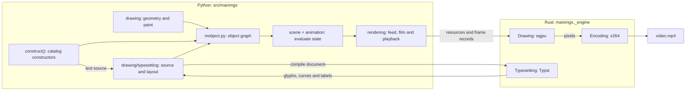

# 理解 ManimGX

本页面跟随一个场景从其代码到其视频：每步做什么、为何如此构建，
以及其代码在哪里。

## 包如何组织

有三件不同的事要跟踪：构造对象、随时间改变其
状态，以及产生输出。`mobjects/` 是构造器的目录；
`mobject.py` 是它们使用的共享可变对象模型。对象持有来自 `drawing/` 的不可变
几何和绘制。`scene.py` 和 `animation/` 求值对象
图，然后 `rendering/` 将其状态转为本机记录、影片和回放。

| 职责 | 实现 |
| --- | --- |
| 对象身份、族、复制、布局、更新器和跟踪器；路径、点云和网格规则 | `mobject.py` |
| authored 形状、绘图、图形、网格、文本、图像和其他构造器 | `mobjects/` |
| 几何算法、不可变形状、仿射混合和运动路径 | `drawing/geometry.py` |
| 颜色解析和插值、不可变笔刷和外观 | `drawing/paint.py` |
| 源和字体环境到拥有的 Typst 布局 | `drawing/typesetting.py` |
| 场景生命周期、成员关系和相机状态，包括专用场景 | `scene.py` |
| 动画窗口、变换、预设、匹配、更新器、缓动和精确时钟 | `animation/` |
| 本机绘制记录、输出会话和回放窗口 | `rendering/feed.py`, `rendering/film.py`, `rendering/window.py` |
| 声音和语音值、字词定时和语音提供者 | `audio/sound.py`, `audio/fal.py` |
| 场景加载、导出、预览、诊断和故事板 | `cli/` |

这些边界遵循所有权。一个绘制值没有可变对象族；
许多对象可以持有同一个形状。目录构造器构建这些对象
但不拥有场景时钟。场景对它们求值；输出层读取
它们已求值的值。排版属于绘制数据，因为布局
在构建任何场景对象之前就包含字形、放置和标签。

配置和帧相对单位位于 `config.py`；共享 authoring
常量和类型别名位于 `constants.py` 和 `typing.py`。`caches.py` 提供
复用和失效策略。每个算法保持自己的缓存值。
字体分发包仍是独立的 Python 包。浏览器演示
模板位于其导出器旁边 `cli/present.html`。

顶层 `manimgx` 模块导出 authoring API，场景仅从它
导入：CE 的模块路径，如 `manim.utils.paths`，没有对应物。语料库
通过在 CE 存放这些名称的地方找到它们，在 CE 上运行相同的场景
（`tests/integration/corpus/run_ce.py`）。实现代码直接导入拥有的模块。

## 核心工作流

一个场景经过构造、求值和输出：



场景的代码描述了发生什么。构造器构建 mobject，其当前
状态引用绘制值；动画和更新器改变该状态。时钟
决定一帧显示哪个瞬间。feed 将已求值的状态转为
本机绘制记录，film 指导输出。Python 决定一帧
显示什么；Rust 绘制其像素并编码视频。

本页面跟随此场景：

```python
import manimgx as m


class UnderstandingManimgx(m.Scene):
    def construct(self) -> None:
        square = m.Square(side_length=3, color=m.BLUE, fill_opacity=0.5)
        label = m.MathTex(r"A = s^2", font_size=64).next_to(square, m.UP)
        self.play(m.Create(square), m.Write(label))
        self.play(square.animate.rotate(m.PI / 4))
```

## 步骤 1：场景运行其代码

`manimgx render scene.py` 加载文件，选择场景并调用
[`Scene.render`][manimgx.Scene.render]。`render` 创建一个新的 [`Film`][manimgx.Film]，调用
`setup`、`construct` 和 `tear_down`，记录一个结束帧，并关闭影片。

`construct` 是普通的 Python，从上到下运行一次。它调用的 API 是 Manim
Community Edition 的：相同的类、方法和参数。CE 的行为并不随
之而来：一个场景意味着什么（其时序、其几何、它的外观）由其自身
优劣决定，因此"Manim CE 这样做"是仔细查看的理由，而不是改变
ManimGX 的理由。调用所做的是 ManimGX 自身的设计，如下所述。

一个 [`Scene`][manimgx.Scene] 持有三样东西：它绘制的 mobject、一个相机和一个时钟。
时间仅在 [`play`][manimgx.Scene.play] 和 [`wait`][manimgx.Scene.wait] 中流逝；它们
两者之间的一切发生在一个瞬间。相机由 mobject 构成（一个帧
矩形、3D 轨道的值跟踪器），因此动画和更新器移动它如同
移动其他任何东西。

见 [`scene.py`](https://github.com/1Cyrvox/ShuJing/blob/main/src/manimgx/scene.py)，
它拥有相机和场景变体以及它们的共享执行模型。

## 步骤 2：Mobject

一个 mobject 是你看到的东西：上面的正方形和公式。它是对象图的一个节点
（一个 [`VGroup`][manimgx.VGroup] 持有其他，组可以共享子节点），带有点、
一个样式、更新器和 z 索引。

### 几何作为形状的混合

几何独立于持有它的对象：一个 mobject 的点是不可变形状的 *混合*，
points = Σₖ Mₖ·Sₖ。一个形状 Sₖ 是一个永不改变的控制点数组，由
其内容标识。一个矩阵 Mₖ 是一个仿射映射。移动、缩放或旋转一个 mobject 组合
一个矩阵并保持形状不变；从一个形状到另一个形状的变形是两项的混合。读取 `points` 计算求和，并缓存它。引擎接收项，
而非求和：旋转正方形发送一个新的矩阵，而非新点。将一个
mobject 赋予它已有的点不改变任何东西（将一个网格赋予其三角形，或一个
paint 赋予其颜色也是如此）：它保持它持有的，以及从它导出的一切。

见 [`drawing/geometry.py`](https://github.com/1Cyrvox/ShuJing/blob/main/src/manimgx/drawing/geometry.py)。
它还拥有数值采样和三次轮廓转换。文本裁剪和 Boolean
形状使用相同的平面路径；`VMobject` 拥有从结果构建可变曲线。

### 绘制

一个 mobject 的样式是一个不可变值，即其 `Paint`：其填充和描边（各有
一个颜色，或多个）、其背景描边、其端点和连接、其虚线，以及它
被揭示的部分。一次更改产生一个新的 paint。每种 mobject 共享它；一种
决定多个颜色的含义：路径上的梯度停靠点、点或顶点颜色，
或每个格子的填充颜色。

见 [`drawing/paint.py`](https://github.com/1Cyrvox/ShuJing/blob/main/src/manimgx/drawing/paint.py)。

### 三种类型

[`Mobject`][manimgx.Mobject] 一次性实现每个 mobject 所做的事：变换、边界、
布局、样式、插值。一种类型仅覆盖它如何被界定、与另一种
同类型对齐，以及被切成部分：

- [`VMobject`][manimgx.VMobject]：三次贝塞尔曲线路径，每条四个控制点。
  正方形是一个。
- [`PMobject`][manimgx.PMobject]：点云。
- [`MeshMobject`][manimgx.MeshMobject]：顶点和三角形，按顶点着色或由
  纹理。其拓扑是一个不可变值：显式三角形索引，或
  采样格子的维度。一个 [`ImageMobject`][manimgx.ImageMobject] 是一个带纹理的
  四边形；一个 [`Surface`][manimgx.Surface] 采样一次格子，每个格子带 paint 和每个样本带 UV。
  渲染导出其平滑样条、格子轮廓和顶点颜色。
  相同格子直接变形；不同拓扑作为独立三角形对齐。

三种类型都位于
[`mobject.py`](https://github.com/1Cyrvox/ShuJing/blob/main/src/manimgx/mobject.py)。
它们共享对象身份、复制、族操作和生命周期；它们的类
保持路径曲线、点颜色和网格拓扑的不同规则明确。

[`mobjects/`](https://github.com/1Cyrvox/ShuJing/tree/main/src/manimgx/mobjects)
目录在这些规则上构建具体绘制。`shapes.py` 构造图形、
曲线分解、虚线路径和 Boolean 区域；`annotations.py` 在对象周围放置标签、
框架和花括号；
`plotting.py` 拥有坐标模型和绘制数据。`grid.py` 为矩阵和表格分组共享
入口模型，保持它们不同的布局。图像、
图形、曲面、向量场和文本同样有各自的构造器。
目录代码使用内核；内核不整批导入目录。

### 文本：源、布局和绘制

公式由 [Typst](https://typst.app) 排版，编译进引擎：在同一个
进程中，无需 TeX 安装。排版构造普通的路径 mobject；它们的
几何、绘制、动画和渲染随后像正方形一样工作。

1. **源。** [`mobjects/text.py`](https://github.com/1Cyrvox/ShuJing/blob/main/src/manimgx/mobjects/text.py)
   持有源前端及其公共构建器。[`Typst`][manimgx.Typst] 接受
   Typst 标记；[`MathTypst`][manimgx.MathTypst] 添加数学分组；
   [`Text`][manimgx.Text] 写入字面字符串和排版运行；
   [`MathTex`][manimgx.MathTex] 和 [`Tex`][manimgx.Tex] 通过引擎的
   [mitex](https://github.com/mitex-rs/mitex) 转换器转换 LaTeX。每个到达同一个排版器。
2. **布局。** [`drawing/typesetting.py`](https://github.com/1Cyrvox/ShuJing/blob/main/src/manimgx/drawing/typesetting.py)
   将源与其前导码、字体和包环境组合。引擎
   排版文档并读取 Typst 的帧：字形放置、绘制、源
   字节范围、三次形状和标记组。Python 保持可绘制行
   和它们引用的不可变轮廓和连字插入符。这是绘制数据；
   它不包含场景对象。
3. **Mobject。** 公共 Typst 构建器将每个字形放置为其不可变
   轮廓和矩阵的混合，给每个部分其绘制，并创建引用
   实际部分的组。字面文本将字形与字符关联；LaTeX 将
   它们与可选公式片段关联。更改一个字符的颜色可以在
   其插入符处拆分连字而不改变排版布局。

布局和字体扫描使用当前用户的缓存目录，或页面运行时
浏览器中的私有文件系统。布局按键源和环境。解码
字形记录在有界缓存中复用，而布局和活动字形持有它们自己需要的内容。清除该缓存不
会使现有文本失效。`MANIMGX_CACHE_DIR` 将两个磁盘缓存重定位到显式
目录，在容器和隔离测试中很有用。字体来自调用者的路径、
已安装的 ManimGX 字体包和 Typst 的嵌入字体；系统字体仅在
文档显式命名的字体族中被考虑。见[引擎](engine.md#typesetting)了解
本机编译器和字体环境。

两个消费者有各自的布局职责。
[`mobjects/code.py`](https://github.com/1Cyrvox/ShuJing/blob/main/src/manimgx/mobjects/code.py)
构建带行和列网格、行号和框架的语法着色列表。
[`mobjects/numbers.py`](https://github.com/1Cyrvox/ShuJing/blob/main/src/manimgx/mobjects/numbers.py)
格式化并布局可在动画期间变化的数字行。两者都使用
排版的 mobject 而非另一个文本渲染器。

SVG 采用单独的输入路径。
[`mobjects/svg.py`](https://github.com/1Cyrvox/ShuJing/blob/main/src/manimgx/mobjects/svg.py)
读取外部矢量绘图，转换其形状和路径，应用其绘制和
变换，并保留其 id 组。它到达相同的几何和绘制模型
而不经过排版器。

## 步骤 3：动画

动画描述对对象图的更改。它们的时序和几何
组合有各自的所有者：一个窗口说明动画何时作用，一个
变换说明它如何更改对象。动画类建立在两个原语上。

- 一个 **tween**，[`Transform`][manimgx.Transform]：它在其 mobject 的叶节点之间
  沿路径在关键帧间移动。大多数类是关键帧、路径和标志的预设。一个揭示
  是绘制（路径被揭示的部分），因此 [`Create`][manimgx.Create] 也是一个 tween。
- 一个 **过程**，[`Animation`][manimgx.Animation]：其进度 α，从 0 到 1，驱动
  更改 mobject 的代码。

在它们之上：

- [`.animate`][manimgx.Mobject.animate] 记录方法调用。当其动画开始时，它
  在 mobject 当时的状态下执行它们，并 tween 到结果。
- [`AnimationGroup`][manimgx.AnimationGroup]、[`LaggedStart`][manimgx.LaggedStart] 和
  [`Succession`][manimgx.Succession] 是一个类。一个组给每个部分一个自己的时间
  窗口，一个部分的 α 仅是那个时间的函数，因此一个组可以在
  任意数量的瞬间一次求值。
- 一起在一个叶节点上开始的 tween 组合：其运动链接它们所有的，
  每个绘制字段是最后更改者的。

见 [`animation/`](https://github.com/1Cyrvox/ShuJing/tree/main/src/manimgx/animation)：
[`timeline.py`](https://github.com/1Cyrvox/ShuJing/blob/main/src/manimgx/animation/timeline.py)
拥有生命周期和嵌套时间窗口；
[`transform.py`](https://github.com/1Cyrvox/ShuJing/blob/main/src/manimgx/animation/transform.py)
拥有关键帧求值、记录的方法调用和并发叶组合；
[`motion.py`](https://github.com/1Cyrvox/ShuJing/blob/main/src/manimgx/animation/motion.py)
在它们之上构建动画预设。时序组合和几何组合
有各自的所有者，因为它们回答不同的问题：一个部分何时作用，以及
其贡献如何与作用于同一对象的其他变换组合。

## 步骤 4：时钟

如果时间是一个每帧前进 1/fps 的浮点数，误差累积，
一个 play 的长度被舍入到整帧，一个给定 `dt = 1/fps` 的物理更新器
在 30 和 60 帧每秒下表现不同。一个场景显示的将取决于其
帧率。

场景时间是精确的，秒的 `Fraction`，帧采样它。
浮点持续时间、滞后比和帧率意味着舍回所提供浮点数的最简有理数：`5 / 6` 保持精确的六分之五，而不同的浮点数保持
不同，正持续时间永不向下舍入为零。组合保持其
计算出的持续时间为分数；观察和动画求值使用浮点数。

- 一个持续时间为 _d_ 的 play 或 wait，在时间 _T_ 开始，拥有观察
  时间落在 [_T_, _T_ + _d_) 中的帧。帧 _k_ 采样 _k_/fps。一个事件和一个舍入到
  相同 binary64 瞬间的样本被一起观察：帧看到那里的每个事件，
  按精确顺序，而不回放最后一个事件。这适用于嵌套
  动画以及连续的 play：使观察
  瞬间保持不变的舍入差异不添加帧。静态导出从这同一个采样网格选择。
- 然后世界被带到 _T_ + _d_ 本身，`construct` 继续。
- 当 `construct` 返回时，一个结束帧显示场景结束时的样子。

在每个瞬间，播放的动画在其时间窗口中的点上求值，
然后更新器运行，然后记录器（如 [`TracedPath`][manimgx.TracedPath]）。
每帧更新器恢复一个关系。一个作为 *流* 的基于时间的更新器在任何
瞬间都是精确的；任何其他基于时间的更新器是 *模拟的*，在自身的
时钟上步进（`config.simulation_rate` 每秒滴答，默认 60），独立于输出帧
率。一个在每次调用上累积更改的每帧回调仍取决于
请求了多少帧；将这种运动表达为时间或恢复的关系。

一个 play 的帧以两种方式之一计算：

- **一次一个瞬间**，一般情况：play 的步骤，然后更新器，每帧。
- **一次全部**，对于作为时间的纯函数的 play：固定
  关键帧之间的 tween，在没有更新器的场景中。其帧一起计算，作为数组。

一个什么都不能改变的 wait 是一帧，保持。

见 [`animation/clock.py`](https://github.com/1Cyrvox/ShuJing/blob/main/src/manimgx/animation/clock.py) 和，
在 [`scene.py`](https://github.com/1Cyrvox/ShuJing/blob/main/src/manimgx/scene.py) 中，
`play`、`_run` 和 `_instant`。用户指南的
[基础](../user-guide/the-basics.md#one-step-after-another)从场景作者看到的
角度描述时钟。

## 步骤 5：影片及其 feed

渲染器消费绘制值而非 Python 对象图。一帧
作为 *视图*（相机的矩阵和背景）和每个对象一个 336 字节的 *记录* 描述给引擎：其两个形状键和
两个 3×4 矩阵（混合的项）、其揭示窗口、其颜色、其梯度或
每顶点颜色行（按键）、其宽度和标志。形状、颜色行和纹理
上传一次，按键为其内容和解释（一个 xxh3 摘要）。同种相等形状
共享 GPU 内存；具有相同坐标的路径和点云
保持独立资源。一段时间没有帧显示的被释放。

[`Film`][manimgx.Film] 发送每帧：

- 到视频，随其到来编码；
- 到一个函数，如果给定，作为 [`Frame`][manimgx.rendering.film.Frame]，仅在
  被要求时绘制其像素；
- 或没有每帧输出：`manimgx inspect` 求值时间线并仅绘制
  选定的故事板快照。

与前一帧相等的帧不再发送：它延长它，成为一个保持。每个 play，
当它结束时，被保持为一个 [`Play`][manimgx.rendering.film.Play]：其精确开始和结束，以及
播放它的场景代码行。

见 [`rendering/film.py`](https://github.com/1Cyrvox/ShuJing/blob/main/src/manimgx/rendering/film.py) 和
[`rendering/feed.py`](https://github.com/1Cyrvox/ShuJing/blob/main/src/manimgx/rendering/feed.py)。

声音遵循相同的场景时间线。`audio/sound.py` 拥有 [`Sound`][manimgx.Sound]
和 [`Speech`][manimgx.Speech]、其编辑和字词时间。场景调度片段
和字幕；影片将它们带入其输出。语音提供者代码在
`audio/fal.py` 中是独立的，而任何返回 Speech 的函数都可以是语音。

## 步骤 6：引擎

引擎是一个 Rust crate，编译为包中的 `manimgx._engine`。它用
[wgpu](https://wgpu.rs) 在 GPU 上绘制记录：路径在
曲线扁平化后使用解析段覆盖，而点云和网格使用光栅管线。视图的
合成组合它们的覆盖、绘制和深度。对于视频，它仅转换
帧中更改的部分，将它们交给 x264 在自己的线程上，并写入
MP4。它还排版。

[引擎](engine.md)描述它。

## 命令行

`manimgx` 命令行是
[`cli/`](https://github.com/1Cyrvox/ShuJing/tree/main/src/manimgx/cli) 中的一个 [Typer](https://typer.tiangolo.com) 应用。
每个命令加载场景文件，选择场景，设置配置，并
用影片的钩子渲染它：一个 *take*。`render` 和 `inspect` 写入带标注的故事板并
报告 2D 布局问题（帧裁掉什么、重叠的文本、穿过
文本的线、在一个之上绘制的填充、太小而无法阅读的文本），在几何上测量。`inspect` 还
列出时间线。它默认采样 play 结尾，
或用 `-t` 采样选定帧；图片和检查使用相同的场景状态。
场景中的错误通过作者自己代码的行显示。
`manimgx preview` 将场景记录为
take 并发送给 [`Window`][manimgx.Window]，一个播放它的独立进程，并
在每次其文件保存时再次运行场景（见[引擎](engine.md#the-player)）。

命令行模块遵循这些操作：`cli/scenes.py` 加载和选择
场景并记录 take；`cli/export.py` 写入视频、检查和演示
页面；`cli/preview.py` 为窗口管理重新记录。`cli/diagnostics.py`
读取可见场景几何并报告布局问题。`cli/storyboard.py`
收集帧表和时间线报告。这些是场景执行
和影片钩子的客户端，而非另一个场景或渲染模型。

[命令行参考](../reference/rendering/command-line.md)列出了每个命令和
选项。

## 依赖

ManimGX 在运行时需要这些包：

| 包 | 它为 ManimGX 做什么 | 位置 |
| --- | --- | --- |
| [numpy](https://numpy.org) | 数组：点、矩阵、颜色、记录 | 到处 |
| [pillow](https://python-pillow.github.io) | 图像：`ImageMobject` 的像素、命令行的表 | `mobjects/images.py`, `cli/storyboard.py` |
| [skia-pathops](https://github.com/fonttools/skia-pathops) | 路径上的 Boolean 操作：`Union`、`Difference`、`Intersection`、`Exclusion` | `mobjects/shapes.py` |
| [svgelements](https://github.com/meerk40t/svgelements) | 读取 SVG：`SVGMobject`、花括号、logo | `mobjects/svg.py` |
| [networkx](https://networkx.org) | 图布局，用于 `Graph` | `mobjects/graph.py` |
| [isosurfaces](https://github.com/jared-hughes/isosurfaces) | `ImplicitFunction` 的曲线 | `mobjects/plotting.py` |
| [typer](https://typer.tiangolo.com) | 命令行 | `cli/` |

引擎自身的依赖是 Rust crate，编译进来：见[引擎](engine.md)。

## 完整管线

当你运行 `manimgx render scene.py` 时：

1. **运行**：场景的 `construct` 运行一次；`play` 和 `wait` 移动其精确时钟。
2. **更改**：动画和更新器更改 mobject，其几何是不可变
   形状的混合，其样式是一个不可变绘制。
3. **采样**：帧 _k_ 显示 _k_/fps 时的世界；纯 play 的帧一次
   计算。
4. **Feed**：每帧成为一个视图和每个对象一个 336 字节的记录；形状
   一次穿越到引擎。
5. **绘制和编码**：引擎在 GPU 上绘制每帧并将更改的
   编码为 H.264 MP4。

## 了解更多

- [`scene.py`](https://github.com/1Cyrvox/ShuJing/blob/main/src/manimgx/scene.py)：一个
  场景的生命周期、`play`、`wait` 和时钟的规则。
- [`mobject.py`](https://github.com/1Cyrvox/ShuJing/blob/main/src/manimgx/mobject.py)：
  每个 mobject 拥有什么。
- [`rendering/feed.py`](https://github.com/1Cyrvox/ShuJing/blob/main/src/manimgx/rendering/feed.py)：
  记录，逐字段。
- 实现模块在模块文档字符串中为更改它们的开发者介绍其设计。API 参考不显示它。