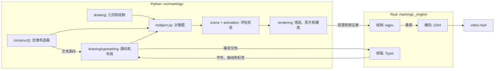

# 理解 ManimGX

本页面跟随一个场景从其代码到其视频：每步做什么、为何如此构建，以及其代码在哪里。

## 包如何组织

有三件不同的事要跟随：构造对象、随时间更改其状态，以及产生输出。`mobjects/` 是构造器的目录；`mobject.py` 是它们使用的共享可变对象模型。对象持有 `drawing/` 中的不可变几何和绘制。`scene.py` 和 `animation/` 评估对象图，然后 `rendering/` 将其状态转为原生记录、影片和播放。

| 职责 | 实现 |
| --- | --- |
| 对象身份、家族、复制、布局、更新器和追踪器；路径、点云和网格规则 | `mobject.py` |
| 编写的形状、绘图、图、网格、文本、图像和其他构造器 | `mobjects/` |
| 几何算法、不可变形状、仿射混合和运动路径 | `drawing/geometry.py` |
| 颜色解析和插值、不可变笔刷和外观 | `drawing/paint.py` |
| 源码和字体环境到拥有的 Typst 布局 | `drawing/typesetting.py` |
| 场景生命周期、成员和相机状态，包括专用场景 | `scene.py` |
| 动画窗口、变换、预设、匹配、更新器、缓动和精确时钟 | `animation/` |
| 原生绘制记录、输出会话和播放窗口 | `rendering/feed.py`、`rendering/film.py`、`rendering/window.py` |
| 声音和语音值、词时和语音提供者 | `audio/sound.py`、`audio/fal.py` |
| 场景加载、导出、预览、诊断和故事板 | `cli/` |

这些边界遵循所有权。绘制值没有可变对象家族；许多对象可以持有同一形状。目录构造器构建那些对象但不拥有场景时钟。场景评估它们；输出层读取其评估值。排版属于绘制数据，因为布局包含字形、位置和标签，在任何场景对象构建之前。

配置和帧相对单位在 `config.py` 中；共享编写常量和类型别名在 `constants.py` 和 `typing.py` 中。`caches.py` 提供复用和失效策略。每个算法保持自己的缓存值。字体分发保持独立的 Python 包。浏览器呈现模板在其导出器旁的 `cli/present.html` 中。

顶层 `manimgx` 模块导出编写 API，场景仅从中导入：CE 的模块路径，如 `manim.utils.paths`，没有对应物。语料库通过在 CE 保留它们之处找到那些名称（`tests/integration/corpus/run_ce.py`）在 CE 上运行相同场景。实现代码直接导入拥有的模块。

## 核心工作流

场景经过构造、评估和输出：



场景的代码描述发生什么。构造器构建 mobject，其当前状态引用绘制值；动画和更新器更改该状态。时钟决定帧显示哪个时刻。馈送将评估状态转为原生绘制记录，影片指导输出。Python 决定帧显示什么；Rust 绘制其像素并编码视频。

本页面跟随此场景：


<video src="../films/UnderstandingManimgx.mp4" autoplay loop muted playsinline controls></video>

```python
import manimgx as m


class UnderstandingManimgx(m.Scene):
    def construct(self) -> None:
        square = m.Square(side_length=3, color=m.BLUE, fill_opacity=0.5)
        label = m.MathTex(r"A = s^2", font_size=64).next_to(square, m.UP)
        self.play(m.Create(square), m.Write(label))
        self.play(square.animate.rotate(m.PI / 4))
```

## 步骤 1：场景运行其代码

`manimgx render scene.py` 加载文件，选择场景并调用
[`Scene.render`][manimgx.Scene.render]。`render` 制作新的 [`Film`][manimgx.Film]，调用 `setup`、`construct` 和 `tear_down`，录制结束帧，并关闭影片。

`construct` 是普通 Python，从上到下运行一次。它调用的 API 是 Manim Community Edition 的：相同的类、方法和参数。CE 的行为不随之而来：场景意味着什么（其时序、其几何、其外观）按其自身优劣决定，因此"Manim CE 这样做"是仔细查看的理由，不是更改 ManimGX 的理由。调用所做的是 ManimGX 自己的设计，如下所述。

[`Scene`][manimgx.Scene] 持有三样东西：它绘制的 mobject、一个相机和一个时钟。时间仅在 [`play`][manimgx.Scene.play] 和 [`wait`][manimgx.Scene.wait] 中流逝；两者之间的一切在一个时刻发生。相机由 mobject 组成（帧矩形、3D 轨道的值追踪器），因此动画和更新器移动它如同移动任何其他。

见 [`scene.py`](https://github.com/academa-labs/manimgx/blob/main/src/manimgx/scene.py)，它拥有相机和场景变体以及其共享执行模型。

## 步骤 2：Mobject

mobject 是你所见的：上面的正方形和公式。它是对象图的节点（[`VGroup`][manimgx.VGroup] 持有其他，组可以共享子节点），带点、样式、更新器和 z 索引。

### 几何作为形状的混合

几何独立于持有它的对象：mobject 的点是不可变形状的 *混合*，
points = Σₖ Mₖ·Sₖ。形状 Sₖ 是从不更改的控制点数组，由其内容标识。矩阵 Mₖ 是仿射映射。移动、缩放或转动 mobject 组合一个矩阵而保持形状不变；从一个形状到另一个的变形是两项的混合。读取 `points` 计算求和，并缓存它。引擎接收项，而非求和：转动正方形发送一个新矩阵，而非新点。将 mobject 赋予其已有的点不更改任何内容（将网格赋予其三角形，或将绘制赋予其颜色也是如此）：它保持其持有的，以及从中推导的一切。

见 [`drawing/geometry.py`](https://github.com/academa-labs/manimgx/blob/main/src/manimgx/drawing/geometry.py)。
它还拥有数值采样和三次轮廓转换。文本裁剪和布尔形状使用相同的平面路径；`VMobject` 拥有从结果构建可变曲线。

### 绘制

mobject 的样式是一个不可变值，其 `Paint`：其填充和描边（各一个颜色，或多个）、其背景描边、其端点和连接、其虚线，以及其揭示的部分。更改制作新绘制。每种 mobject 共享它；一种决定多个颜色的含义：路径上的渐变停止、点或顶点颜色，或每格的填充颜色。

见 [`drawing/paint.py`](https://github.com/academa-labs/manimgx/blob/main/src/manimgx/drawing/paint.py)。

### 三种类型

[`Mobject`][manimgx.Mobject] 一次实现每个 mobject 所做的：变换、边界、布局、样式、插值。一种仅覆盖其如何界定、与同种对齐，以及切成部分：

- [`VMobject`][manimgx.VMobject]：三次 Bézier 曲线路径，每条四个控制点。正方形是一个。
- [`PMobject`][manimgx.PMobject]：点云。
- [`MeshMobject`][manimgx.MeshMobject]：顶点和三角形，每顶点着色或由纹理着色。其拓扑是一个不可变值：显式三角形索引，或采样格的维度。[`ImageMobject`][manimgx.ImageMobject] 是纹理化四边形；[`Surface`][manimgx.Surface] 采样格一次，每格带绘制，每样本带 UV。渲染推导其平滑样条、格轮廓和顶点颜色。相等格直接变形；不同拓扑作为独立三角形对齐。

三种类型都在
[`mobject.py`](https://github.com/academa-labs/manimgx/blob/main/src/manimgx/mobject.py) 中。
它们共享对象身份、复制、家族操作和生命周期；其类保持路径曲线、点颜色和网格拓扑的不同规则明确。

[`mobjects/`](https://github.com/academa-labs/manimgx/tree/main/src/manimgx/mobjects)
目录在这些规则上构建具体绘制。`shapes.py` 构造图形、曲线分解、虚线路径和布尔区域；`annotations.py` 在对象旁放置标签、帧和括号；
`plotting.py` 拥有坐标模型和绘制数据。`grid.py` 为矩阵和表格分组共享条目模型，保持其不同布局。图像、图、表面、向量场和文本同样有各自的构造器。目录代码使用内核；内核不整体导入目录。

### 文本：源码、布局和绘制

公式由 [Typst](https://typst.app) 排版，编译到引擎中：在同一进程中，无需 TeX 安装。排版构造普通路径 mobject；其几何、绘制、动画和渲染随后如正方形般工作。

1. **源码。** [`mobjects/text.py`](https://github.com/academa-labs/manimgx/blob/main/src/manimgx/mobjects/text.py)
   持有源码前端及其通用构建器。[`Typst`][manimgx.Typst] 接受 Typst 标记；[`MathTypst`][manimgx.MathTypst] 添加数学分组；
   [`Text`][manimgx.Text] 写入字面字符串和排版运行；
   [`MathTex`][manimgx.MathTex] 和 [`Tex`][manimgx.Tex] 通过引擎的
   [mitex](https://github.com/mitex-rs/mitex) 转换器转换 LaTeX。每个到达同一排版器。
2. **布局。** [`drawing/typesetting.py`](https://github.com/academa-labs/manimgx/blob/main/src/manimgx/drawing/typesetting.py)
   将源码与其前导、字体和包环境组合。引擎排版文档并读取 Typst 的帧：字形位置、绘制、源码字节范围、三次形状和标记组。Python 保持可绘制行及其引用的不可变轮廓和连字插入符。这是绘制数据；它不含场景对象。
3. **Mobject。** 通用 Typst 构建器将每个字形放置为其不可变轮廓和矩阵的混合，给每部分其绘制，并创建引用实际部分的组。字面文本将字形与字符关联；LaTeX 将它们与可选公式片段关联。更改字符颜色可以在其插入符处拆分连字而不更改排版布局。

布局和字体扫描使用当前用户的缓存目录，或浏览器中页面运行时的私有文件系统。布局按键源码和环境。解码字形记录在有界缓存中复用，而布局和活动字形保持各自所需。清除该缓存不会使现有文本失效。`MANIMGX_CACHE_DIR` 将两个磁盘缓存重定位到显式目录，在容器和隔离测试中有用。字体来自调用者的路径、已安装的 ManimGX 字体包和 Typst 的嵌入字体；系统字体仅在文档显式命名的族中考虑。见](engine.md#_9)了解原生编译器和字体环境。

两个消费者有自己的布局职责。
[`mobjects/code.py`](https://github.com/academa-labs/manimgx/blob/main/src/manimgx/mobjects/code.py)
用行和列网格、行号和帧构建语法着色的列表。
[`mobjects/numbers.py`](https://github.com/academa-labs/manimgx/blob/main/src/manimgx/mobjects/numbers.py)
格式化并布局可在动画期间更改的数字行。两者使用排版的 mobject 而非另一个文本渲染器。

SVG 采用单独的输入路径。
[`mobjects/svg.py`](https://github.com/academa-labs/manimgx/blob/main/src/manimgx/mobjects/svg.py)
读取外部矢量绘图，转换其形状和路径，应用其绘制和变换，并保留其 id 组。它到达同一几何和绘制模型而不经过排版器。

## 步骤 3：动画

动画描述对对象图的更改。其时序和几何组合有分开的所有者：窗口说动画何时作用，变换说它如何更改对象。动画类建立在两个原语上。

- **补间**，[`Transform`][manimgx.Transform]：在其 mobject 的叶之间沿路径在关键帧间移动。大多数类是关键帧、路径和标志的预设。揭示是绘制（路径的揭示部分），因此 [`Create`][manimgx.Create] 也是补间。
- **过程**，[`Animation`][manimgx.Animation]：其进度 α，从 0 到 1，驱动更改 mobject 的代码。

在它们之上：

- [`.animate`][manimgx.Mobject.animate] 记录方法调用。当其动画开始时，它在 mobject 当时状态下执行它们，并补间到结果。
- [`AnimationGroup`][manimgx.AnimationGroup]、[`LaggedStart`][manimgx.LaggedStart] 和
  [`Succession`][manimgx.Succession] 是一个类。组给每部分其自己时间的窗口，部分的 α 仅是那个时间的函数，因此组可以在任意多个时刻一次评估。
- 在一个叶上一起开始的补间组合：其运动链接所有它们的，每个绘制字段是最后更改者的。

见 [`animation/`](https://github.com/academa-labs/manimgx/tree/main/src/manimgx/animation)：
[`timeline.py`](https://github.com/academa-labs/manimgx/blob/main/src/manimgx/animation/timeline.py)
拥有生命周期和嵌套时间窗口；
[`transform.py`](https://github.com/academa-labs/manimgx/blob/main/src/manimgx/animation/transform.py)
拥有关键帧评估、记录的方法调用和并发叶组合；
[`motion.py`](https://github.com/academa-labs/manimgx/blob/main/src/manimgx/animation/motion.py)
在其上构建动画预设。时序组合和几何组合有分开的所有者，因为它们回答不同问题：部分何时作用，以及其贡献如何与作用在同一对象上的其他变换组合。

## 步骤 4：时钟

如果时间是每帧前进 1/fps 的浮点数，误差累积，
播放的长度舍入到整帧，给定 `dt = 1/fps` 的物理更新器在每秒 30 和 60 帧时行为不同。场景显示的内容将取决于其帧率。

场景时间是精确的，秒的 `Fraction`，帧采样它。浮点持续时间、滞后比和帧率意味着舍回所提供浮点的最简单有理数：`5 / 6` 保持精确的六分之五，而不同的浮点保持不同，正持续时间从不舍入到零。组合保持其计算持续时间为分数；观察和动画评估使用浮点。

- 持续时间 _d_ 在时间 _T_ 开始的播放或等待拥有观察时间落在 [_T_, _T_ + _d_) 中的帧。帧 _k_ 采样 _k_/fps。舍入到同一 binary64 时刻的事件和样本一起观察：帧看到那里的每个事件，按精确顺序，不倒带最后一个事件。这适用于嵌套动画和连续播放：舍入差异使观察时刻不变的不添加帧。静态导出从此同一采样格选择。
- 然后世界带到 _T_ + _d_ 本身，`construct` 在此继续。
- 当 `construct` 返回时，结束帧显示场景结束时的样子。

在每个时刻，播放的动画在其时间窗口的点评估，然后更新器运行，然后记录器（如 [`TracedPath`][manimgx.TracedPath]）。每帧更新器恢复关系。是 *流* 的基于时间的更新器在任何时刻精确；任何其他基于时间的更新器是 *模拟的*，在自身时钟上步进（`config.simulation_rate` 每秒滴答，默认 60），独立于输出帧率。在每次调用上累积更改的每帧回调仍取决于请求多少帧；将此类运动用时间表达或作为恢复的关系。

播放的帧以两种方式之一计算：

- **一次一个时刻**，一般情况：播放的步骤，然后更新器，每帧。
- **一次全部**，对于时间的纯函数的播放：固定关键帧间的补间，在无更新器的场景中。其帧一起计算，作为数组。

无可更改的等待是一帧，保持。

见 [`animation/clock.py`](https://github.com/academa-labs/manimgx/blob/main/src/manimgx/animation/clock.py) 以及
[`scene.py`](https://github.com/academa-labs/manimgx/blob/main/src/manimgx/scene.py) 中的
`play`、`_run` 和 `_instant`。用户指南的
[基础](../user-guide/the-basics.md#_3) 按场景作者所见描述时钟。

## 步骤 5：影片及其馈送

渲染器消费绘制值而非 Python 对象图。帧作为 *视图*（相机矩阵和背景）和每个对象一个 336 字节 *记录* 描述给引擎：其两个形状键和两个 3×4 矩阵（混合的项）、其揭示窗口、其颜色、其渐变或每顶点颜色行（按键）、其宽度和标志。形状、颜色行和纹理上传一次，按键其内容和解释（xxh3 摘要）。同种相等形状共享 GPU 内存；具有相同坐标的路径和点云保持独立资源。一段时间无帧显示的被释放。

[`Film`][manimgx.Film] 发送每帧：

- 到视频，随其到来编码；
- 到函数，如果给定，作为 [`Frame`][manimgx.rendering.film.Frame]，仅在要求时绘制其像素；
- 或无每帧输出：`manimgx inspect` 评估时间线并仅绘制选定的故事板快照。

与前一个相等的帧不再发送：它延长它，成为保持。每个播放，在结束时，保持为 [`Play`][manimgx.rendering.film.Play]：其精确开始和结束，以及播放它的场景代码行。

见 [`rendering/film.py`](https://github.com/academa-labs/manimgx/blob/main/src/manimgx/rendering/film.py) 和
[`rendering/feed.py`](https://github.com/academa-labs/manimgx/blob/main/src/manimgx/rendering/feed.py)。

声音遵循同一场景时间线。`audio/sound.py` 拥有 [`Sound`][manimgx.Sound]
和 [`Speech`][manimgx.Speech]，其编辑和词时。场景调度片段和字幕；影片将它们带入其输出。语音提供者代码在 `audio/fal.py` 中分开，而任何返回 Speech 的函数都可以是语音。

## 步骤 6：引擎

引擎是编译到包中的 Rust crate `manimgx._engine`。它用 [wgpu](https://wgpu.rs) 在 GPU 上绘制记录：路径在曲线展平后使用解析段覆盖，而点云和网格使用光栅管线。视图的合成组合其覆盖、绘制和深度。对于视频，它仅转换帧中更改的部分，在其自己的线程上交给 x264，并写入 MP4。它还排版。

[引擎](engine.md) 描述它。

## 命令行

`manimgx` 命令行是
[`cli/`](https://github.com/academa-labs/manimgx/tree/main/src/manimgx/cli) 中的 [Typer](https://typer.tiangolo.com) 应用。
每个命令加载场景文件，选择场景，设置配置，并用影片的 hook 渲染它：一个 *take*。`render` 和 `inspect` 写带注释的故事板并报告 2D 布局问题（帧裁掉什么、重叠的文本、穿过文本的线、绘制在填充上的内容、太小无法阅读的文本），在几何上测量。`inspect` 还列出时间线。它默认采样播放结尾，或用 `-t` 选定帧；图片和检查使用同一场景状态。场景中的错误通过作者自己代码的行显示。
`manimgx preview` 将场景记录为 take 并发送到 [`Window`][manimgx.Window]，一个自己播放它的进程，并在每次保存其文件时再次运行场景（见](engine.md#_10)）。

命令行模块遵循那些操作：`cli/scenes.py` 加载和选择场景并记录 take；`cli/export.py` 写视频、检查和呈现页面；`cli/preview.py` 管理窗口的重新记录。`cli/diagnostics.py`
读取可见场景几何并报告布局问题。`cli/storyboard.py`
收集帧表和时间线报告。这些是场景执行和影片 hook 的客户端，而非另一个场景或渲染模型。

[命令行参考](../reference/rendering/command-line.md) 列出每个命令和选项。

## 依赖

ManimGX 运行时需要这些包：

| 包 | 为 ManimGX 做什么 | 位置 |
| --- | --- | --- |
| [numpy](https://numpy.org) | 数组：点、矩阵、颜色、记录 | 各处 |
| [pillow](https://python-pillow.github.io) | 图像：`ImageMobject` 的像素、命令行的表 | `mobjects/images.py`、`cli/storyboard.py` |
| [skia-pathops](https://github.com/fonttools/skia-pathops) | 路径上的布尔操作：`Union`、`Difference`、`Intersection`、`Exclusion` | `mobjects/shapes.py` |
| [svgelements](https://github.com/meerk40t/svgelements) | 读取 SVG：`SVGMobject`、括号、logo | `mobjects/svg.py` |
| [networkx](https://networkx.org) | 图布局，用于 `Graph` | `mobjects/graph.py` |
| [isosurfaces](https://github.com/jared-hughes/isosurfaces) | `ImplicitFunction` 的曲线 | `mobjects/plotting.py` |
| [typer](https://typer.tiangolo.com) | 命令行 | `cli/` |

引擎自己的依赖是 Rust crate，编译在内：见[引擎](engine.md)。

## 完整管线

运行 `manimgx render scene.py` 时：

1. **运行**：场景的 `construct` 运行一次；`play` 和 `wait` 移动其精确时钟。
2. **更改**：动画和更新器更改 mobject，其几何是不可变形状的混合，其样式是一个不可变绘制。
3. **采样**：帧 _k_ 显示 _k_/fps 时的世界；纯播放的帧一次计算。
4. **馈送**：每帧变为视图和每对象 336 字节记录；形状跨越到引擎一次。
5. **绘制和编码**：引擎在 GPU 上绘制每帧并将更改编码为 H.264 MP4。

## 了解更多

- [`scene.py`](https://github.com/academa-labs/manimgx/blob/main/src/manimgx/scene.py)：场景的生命周期、`play`、`wait` 和时钟规则。
- [`mobject.py`](https://github.com/academa-labs/manimgx/blob/main/src/manimgx/mobject.py)：每个 mobject 拥有什么。
- [`rendering/feed.py`](https://github.com/academa-labs/manimgx/blob/main/src/manimgx/rendering/feed.py)：记录，逐字段。
- 实现模块在其模块文档字符串中为更改它们的开发者介绍其设计。API 参考不显示它。