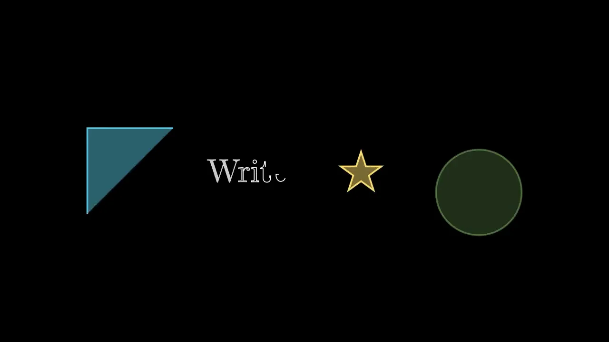

# 出现与消失




```python fold title="影片代码"
import manimgx as m


class AppearHero(m.Scene):
    def construct(self) -> None:
        square = m.Square(color=m.BLUE, fill_opacity=0.5)
        word = m.Text("Write", font_size=56)
        star = m.Star(color=m.YELLOW, fill_opacity=0.5)
        circle = m.Circle(color=m.GREEN, fill_opacity=0.5)

        shapes = m.VGroup(square, word, star, circle).arrange(buff=0.8)
        self.play(
            m.Create(square),
            m.Write(word),
            m.GrowFromCenter(star),
            m.FadeIn(circle, shift=m.UP),
        )
        self.play(
            m.Uncreate(square),
            m.Unwrite(word),
            m.ShrinkToCenter(star),
            m.FadeOut(circle, shift=m.DOWN),
        )
```

使 mobject 出现的动画在开始时将其加入场景：你无需事先添加。使 mobject 消失的动画在结束时将其
从场景移除。在此之间，mobject 沿其路径被绘制、如手写般被书写、淡入或从一点放大。

## 绘制与书写

::: manimgx.Create
    options:
      heading_level: 3

::: manimgx.Uncreate
    options:
      heading_level: 3

::: manimgx.DrawBorderThenFill
    options:
      heading_level: 3

::: manimgx.Write
    options:
      heading_level: 3

::: manimgx.Unwrite
    options:
      heading_level: 3

## 淡入淡出

::: manimgx.FadeIn
    options:
      heading_level: 3

::: manimgx.FadeOut
    options:
      heading_level: 3

## 放大与缩小

::: manimgx.GrowFromCenter
    options:
      heading_level: 3

::: manimgx.GrowFromPoint
    options:
      heading_level: 3

::: manimgx.GrowFromEdge
    options:
      heading_level: 3

::: manimgx.GrowArrow
    options:
      heading_level: 3

::: manimgx.SpinInFromNothing
    options:
      heading_level: 3

::: manimgx.ShrinkToCenter
    options:
      heading_level: 3

::: manimgx.SpiralIn
    options:
      heading_level: 3

## 逐部分

::: manimgx.ShowIncreasingSubsets
    options:
      heading_level: 3

::: manimgx.ShowSubmobjectsOneByOne
    options:
      heading_level: 3

## 逐字输入文本

::: manimgx.AddTextLetterByLetter
    options:
      heading_level: 3

::: manimgx.RemoveTextLetterByLetter
    options:
      heading_level: 3

::: manimgx.AddTextWordByWord
    options:
      heading_level: 3

::: manimgx.TypeWithCursor
    options:
      heading_level: 3

::: manimgx.UntypeWithCursor
    options:
      heading_level: 3