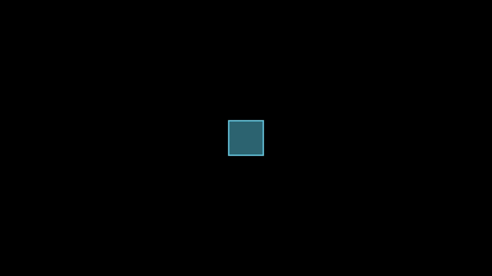
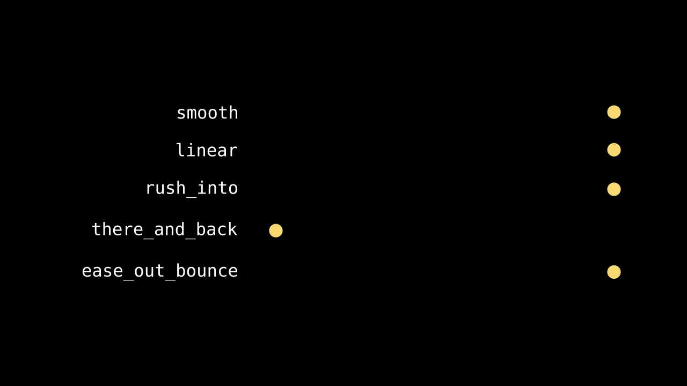
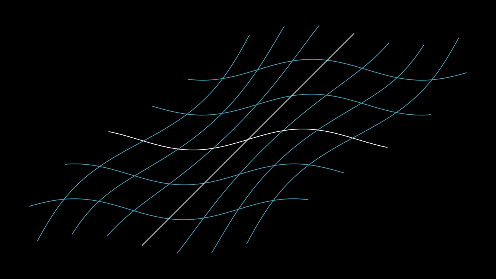
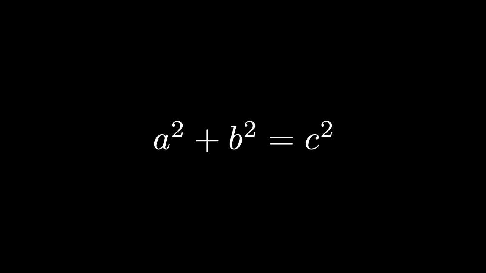

# 动画


```python fold title="影片代码"
import manimgx as m


class AnimationsHero(m.Scene):
    def construct(self) -> None:
        square = m.Square(color=m.BLUE, fill_opacity=0.5)
        circle = m.Circle(color=m.PINK, fill_opacity=0.5)
        self.play(m.Create(square))
        self.play(square.animate.shift(2 * m.LEFT).rotate(m.PI / 4))
        self.play(m.Transform(square, circle))
        self.play(m.Indicate(square))
        self.play(square.animate.set_color(m.YELLOW).shift(2 * m.RIGHT))
        self.wait()
```

动画随时间改变 mobject。[play][manimgx.Scene.play] 播放它：场景的
时间推进动画的 `run_time`（默认 1 秒，你也可以指定其他值），每一帧展示该时刻的变化状态。其
`rate_func` 控制节奏：默认先慢后快再慢，你也可以指定其他方式。

任何方法所做的改变都可以动画化：在方法前加上 `.animate`，
`self.play(square.animate.shift(m.RIGHT))`。下面的动画实现方法无法做到的改变：绘制形状、
书写文字、将一个 mobject 变为另一个、闪烁一个点。多个动画可以在一次 `play` 中同时播放，
也可以在一个组中依次播放。

<div class="grid cards mx-cards" markdown>

-   

    [**动画化一个改变**](animate.md)

    ---

    `.animate`：任意方法调用，动画化。移动到目标，或恢复到保存的状态。

-   

    [**速率函数**](rate-functions.md)

    ---

    动画如何把握节奏：平滑、匀速、弹跳或摆动。

-   

    [**出现与消失**](appear-and-disappear.md)

    ---

    绘制、书写、淡入和放大 mobject 使其出现，再让它们消失。

-   <video src="../../films/TransformsHero.mp4" autoplay loop muted playsinline controls></video>

    [**变换**](transforms.md)

    ---

    将一个 mobject 变为另一个，匹配两个公式的各部分，交换位置。

-   

    [**移动与变形**](move-and-deform.md)

    ---

    绕点旋转、沿路径移动，或通过函数移动每个点。

-   

    [**强调**](emphasis.md)

    ---

    吸引视线：指示、环绕、闪烁、摆动。

-   <video src="../../films/TogetherHero.mp4" autoplay loop muted playsinline controls></video>

    [**同时与依次**](together-and-in-turn.md)

    ---

    同时播放动画、一个接一个播放，或每个在前一个之后稍迟播放。

</div>

## 动画

每个动画都接受动画关键字参数：运行时长、节奏方式，以及各部分依次启动的方式。

::: manimgx.animation.timeline.AnimationOptions
    options:
      heading_level: 3
      inherited_members: true
      members: [run_time, rate_func, lag_ratio, reverse_rate_function, remover, introducer, suspend_mobject_updating, use_override, name]

::: manimgx.Animation
    options:
      heading_level: 3