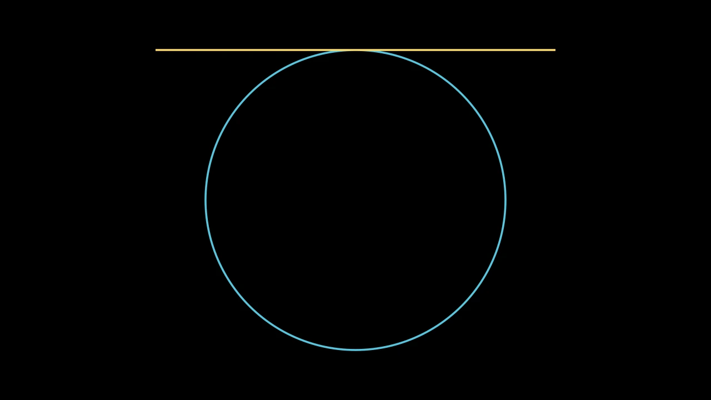

# 相机




```python fold title="影片代码"
import manimgx as m


class CameraHero(m.Scene):
    def construct(self) -> None:
        circle = m.Circle(radius=3, color=m.BLUE)
        tangent = m.Line(4 * m.LEFT, 4 * m.RIGHT, color=m.YELLOW).shift(3 * m.UP)
        self.add(circle, tangent)
        frame = self.camera.frame
        self.play(frame.animate.scale(0.25).move_to(3 * m.UP), run_time=2)
        self.wait()
        self.play(frame.animate.scale(4).move_to(m.ORIGIN), run_time=2)
```

每个场景都有一个相机 `self.camera`。其画框 `self.camera.frame` 是一个 mobject：
移动它来平移，缩放它来缩放，像对待任何其他 mobject 一样动画化它。画框缩小一半，
画面中的一切就放大一倍。

相机还设置画面的外观：其背景色，以及（在 3D 中）其曝光、色调映射、泛光与阴影。

::: manimgx.Camera
    options:
      heading_level: 2
      members: false

## 画框

::: manimgx.Camera.frame
    options:
      heading_level: 3

::: manimgx.Camera.frame_center
    options:
      heading_level: 3

::: manimgx.Camera.frame_width
    options:
      heading_level: 3

::: manimgx.Camera.frame_height
    options:
      heading_level: 3

::: manimgx.Camera.auto_zoom
    options:
      heading_level: 3

## 外观

::: manimgx.Camera.background_color
    options:
      heading_level: 3

::: manimgx.Camera.background_opacity
    options:
      heading_level: 3

::: manimgx.Camera.exposure
    options:
      heading_level: 3

::: manimgx.Camera.tone_mapping
    options:
      heading_level: 3

::: manimgx.Camera.bloom
    options:
      heading_level: 3

::: manimgx.Camera.ambient_occlusion
    options:
      heading_level: 3

::: manimgx.Camera.ambient_occlusion_radius
    options:
      heading_level: 3

::: manimgx.Camera.light_source
    options:
      heading_level: 3

## 屏幕上固定

::: manimgx.Camera.fixed_in_frame_mobjects
    options:
      heading_level: 3

::: manimgx.Camera.add_fixed_in_frame_mobjects
    options:
      heading_level: 3

## 3D 中的角度

::: manimgx.Camera.three_d
    options:
      heading_level: 3

::: manimgx.Camera.get_phi
    options:
      heading_level: 3

::: manimgx.Camera.get_theta
    options:
      heading_level: 3

::: manimgx.Camera.get_gamma
    options:
      heading_level: 3

::: manimgx.Camera.get_zoom
    options:
      heading_level: 3

::: manimgx.Camera.get_focal_distance
    options:
      heading_level: 3

::: manimgx.Camera.set_phi
    options:
      heading_level: 3

::: manimgx.Camera.set_theta
    options:
      heading_level: 3

::: manimgx.Camera.set_gamma
    options:
      heading_level: 3