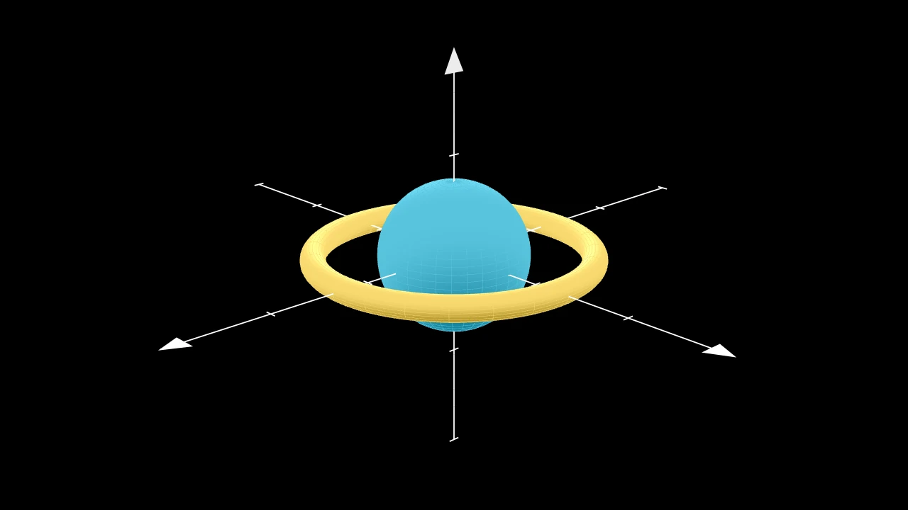
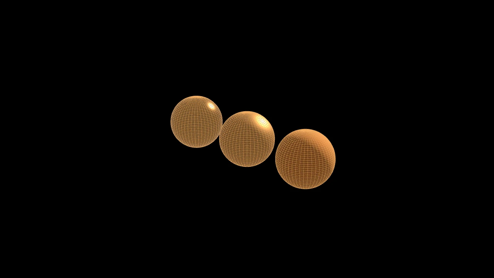

# 相机与 3D




```python fold title="影片代码"
import manimgx as m


class CameraAnd3DHero(m.ThreeDScene):
    def construct(self) -> None:
        self.set_camera_orientation(phi=70 * m.DEGREES, theta=-45 * m.DEGREES)
        axes = m.ThreeDAxes(x_range=[-3, 3], y_range=[-3, 3], z_range=[-2, 2])
        sphere = m.Sphere(radius=1.2, resolution=(32, 32)).set_color(m.BLUE)
        torus = m.Torus(major_radius=2.2, minor_radius=0.2).set_color(m.YELLOW)
        self.add(m.SunLight(4 * m.UP + 3 * m.OUT), m.AmbientLight(intensity=0.3))
        self.add(axes, sphere, torus)
        self.begin_ambient_camera_rotation(rate=0.4)
        self.wait(4)
```

相机决定视频显示什么。其画面是场景中的一个矩形：即用于度量位置的画框。移动画框，视图随之移动；
缩放画框，视图随之缩放。在三维中，相机从你选择的角度观察画框，并在场景播放时绕其旋转。

每个 mobject 都有三个坐标，因此平面 mobject 也能在 3D 中显示。曲面与立体正是为此而设，
灯光则为它们着色。

<div class="grid cards mx-cards" markdown>

-   

    [**相机**](camera.md)

    ---

    画框：平移与缩放。画面的外观，以及在屏幕上保持固定的内容。

-   <video src="../../films/ThreeDScenesHero.mp4" autoplay loop muted playsinline controls></video>

    [**3D 场景**](three-d-scenes.md)

    ---

    从任意角度观察场景，移动相机，绕场景旋转。

-   <video src="../../films/SurfacesHero.mp4" autoplay loop muted playsinline controls></video>

    [**曲面与立体**](surfaces-and-solids.md)

    ---

    函数曲面、球面、环面、圆柱、圆锥、立方体与多面体。

-   

    [**灯光与材质**](lights-and-materials.md)

    ---

    太阳光、点光源、聚光灯与环境光，以及曲面如何反射它们。

</div>