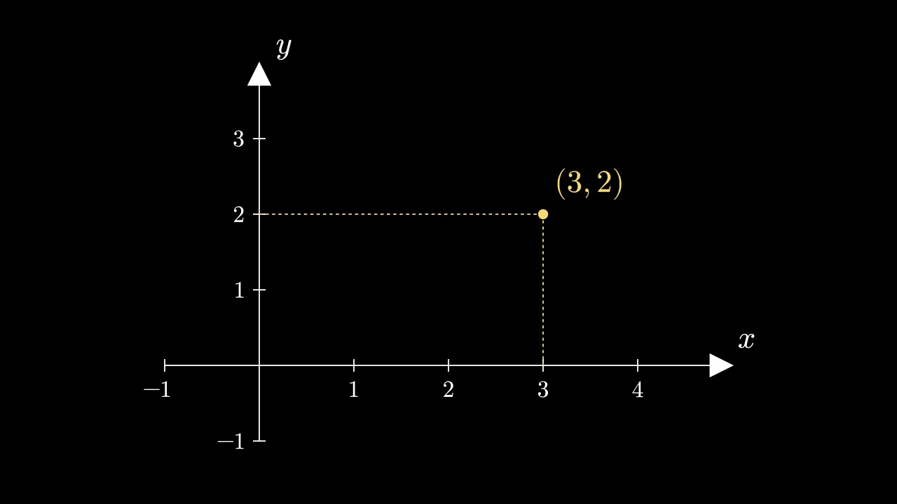

# 坐标轴




```python fold title="影片代码"
import manimgx as m


class AxesHero(m.Scene):
    def construct(self) -> None:
        axes = m.Axes(x_range=[-1, 5, 1], y_range=[-1, 4, 1], x_length=9, y_length=6)
        axes.add_coordinates()
        names = axes.get_axis_labels("x", "y")
        point = axes.c2p(3, 2)
        dot = m.Dot(point, color=m.YELLOW)
        lines = axes.get_lines_to_point(point, color=m.YELLOW)
        label = m.MathTex("(3, 2)", color=m.YELLOW).next_to(dot, m.UR, buff=0.15)
        self.play(m.Create(axes), m.Write(names))
        self.play(m.GrowFromCenter(dot), m.Create(lines), m.Write(label))
        self.wait()
```

坐标轴的每条轴有一个范围 `[start, end, step]` 和在画面中的长度：
`x_range=[-3, 3, 1]` 将 x 轴从 −3 编号到 3，每个单位一个刻度，
`x_length=8` 使其长 8 个单位。坐标轴的坐标是其自身的：x 为 2
且 y 为 4 的点是 `axes.c2p(2, 4)`，无论坐标轴在哪里、有多长。

::: manimgx.Axes
    options:
      heading_level: 2
      members: [x_range, y_range, x_axis, y_axis, axes]

## 坐标

::: manimgx.Axes.coords_to_point
    options:
      heading_level: 3

::: manimgx.Axes.point_to_coords
    options:
      heading_level: 3

::: manimgx.Axes.polar_to_point
    options:
      heading_level: 3

::: manimgx.Axes.get_origin
    options:
      heading_level: 3

::: manimgx.Axes.get_x_unit_size
    options:
      heading_level: 3

::: manimgx.Axes.get_y_unit_size
    options:
      heading_level: 3

## 各轴

::: manimgx.Axes.get_x_axis
    options:
      heading_level: 3

::: manimgx.Axes.get_y_axis
    options:
      heading_level: 3

::: manimgx.Axes.get_z_axis
    options:
      heading_level: 3

::: manimgx.Axes.get_axis
    options:
      heading_level: 3

::: manimgx.Axes.get_axes
    options:
      heading_level: 3

## 标签和数字

::: manimgx.Axes.add_coordinates
    options:
      heading_level: 3

::: manimgx.Axes.get_axis_labels
    options:
      heading_level: 3

::: manimgx.Axes.get_x_axis_label
    options:
      heading_level: 3

::: manimgx.Axes.get_y_axis_label
    options:
      heading_level: 3

## 到某点的连线

::: manimgx.Axes.get_vertical_line
    options:
      heading_level: 3

::: manimgx.Axes.get_horizontal_line
    options:
      heading_level: 3

::: manimgx.Axes.get_lines_to_point
    options:
      heading_level: 3

## 三维坐标轴

::: manimgx.ThreeDAxes
    options:
      heading_level: 3