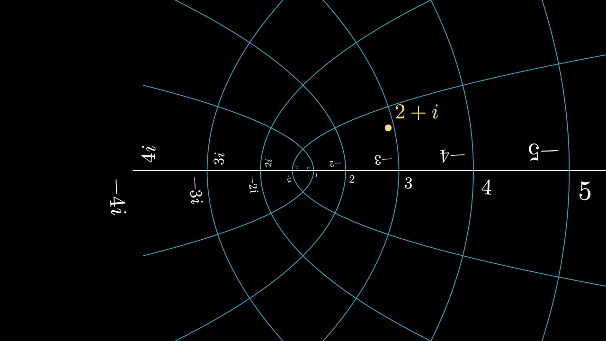

# 平面




```python fold title="影片代码"
import manimgx as m


class PlanesHero(m.Scene):
    def construct(self) -> None:
        plane = m.ComplexPlane().add_coordinates()
        z = m.Dot(plane.n2p(2 + 1j), color=m.YELLOW)
        label = m.MathTex("2 + i", color=m.YELLOW).next_to(z, m.UR, buff=0.1)
        self.play(m.Create(plane, run_time=2))
        self.play(m.GrowFromCenter(z), m.Write(label))
        self.play(plane.animate.apply_complex_function(lambda w: w**2 / 4), run_time=3)
        self.wait()
```

平面是带网格的坐标轴：每条轴的每个步长处有一条线。除非你指定大小，
否则数平面填满画面，使用画面自身的坐标，因此平面上的点就是
画面的点：它是用来观察位置的网格。复平面将点读取为
复数，极坐标平面围绕中心绘制圆和从中心发出的射线。

平面连同其上的所有内容一起弯曲：先插入更多曲线
（[prepare_for_nonlinear_transform][manimgx.NumberPlane.prepare_for_nonlinear_transform]），
其线条就会平滑弯曲。

::: manimgx.NumberPlane
    options:
      heading_level: 2
      inherited_members: [prepare_for_nonlinear_transform]

::: manimgx.ComplexPlane
    options:
      heading_level: 2

::: manimgx.PolarPlane
    options:
      heading_level: 2

## 复数与点

点 `[x, y, 0]` 代表复数 x + yi。

::: manimgx.complex_to_R3
    options:
      heading_level: 3

::: manimgx.R3_to_complex
    options:
      heading_level: 3

::: manimgx.complex_func_to_R3_func
    options:
      heading_level: 3