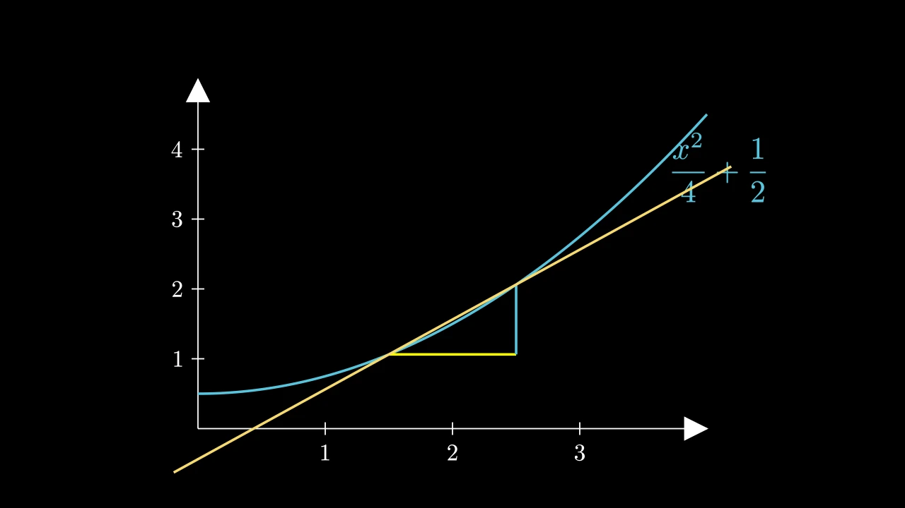

# 绘图




```python fold title="影片代码"
import manimgx as m


def curve(x: float) -> float:
    return 0.25 * x**2 + 0.5


class PlottingHero(m.Scene):
    def construct(self) -> None:
        axes = m.Axes(x_range=[0, 4, 1], y_range=[0, 5, 1], x_length=8, y_length=5.5)
        axes.add_coordinates()
        graph = axes.plot(curve, color=m.BLUE)
        label = axes.get_graph_label(graph, r"\frac{x^2}{4} + \frac{1}{2}", x_val=3.6)
        rectangles = axes.get_riemann_rectangles(
            graph, x_range=[1, 3], dx=0.25, fill_opacity=0.6
        )
        slope = axes.get_secant_slope_group(
            1.5, graph, dx=1, secant_line_color=m.YELLOW
        )
        self.play(m.Create(axes))
        self.play(m.Create(graph), m.Write(label))
        self.play(
            m.LaggedStart(
                *[m.GrowFromEdge(r, m.DOWN) for r in rectangles], lag_ratio=0.1
            )
        )
        self.play(m.FadeOut(rectangles), m.Create(slope))
        self.wait()
```

[plot][manimgx.Axes.plot] 在坐标轴上以坐标轴的坐标绘制 Python x 函数的图：
它是一条曲线，一个与其他任何 mobject 一样的 mobject，可以设置样式和动画化。
坐标轴然后创建解释它的内容：末端的标签、下方的面积、积分的矩形、
某点的斜率、导数的图。

这些方法创建新 mobject，不添加任何东西：将它们添加到场景中，或动画化。

## 图

::: manimgx.Axes.plot
    options:
      heading_level: 3

::: manimgx.Axes.plot_line_graph
    options:
      heading_level: 3

::: manimgx.Axes.plot_polar_graph
    options:
      heading_level: 3

::: manimgx.Axes.plot_implicit_curve
    options:
      heading_level: 3

::: manimgx.Axes.plot_derivative_graph
    options:
      heading_level: 3

::: manimgx.Axes.plot_antiderivative_graph
    options:
      heading_level: 3

## 图上的点

::: manimgx.Axes.input_to_graph_point
    options:
      heading_level: 3

::: manimgx.Axes.i2gp
    options:
      heading_level: 3

::: manimgx.Axes.input_to_graph_coords
    options:
      heading_level: 3

::: manimgx.Axes.get_graph_label
    options:
      heading_level: 3

::: manimgx.Axes.get_T_label
    options:
      heading_level: 3

::: manimgx.Axes.get_vertical_lines_to_graph
    options:
      heading_level: 3

## 面积

::: manimgx.Axes.get_area
    options:
      heading_level: 3

::: manimgx.Axes.get_riemann_rectangles
    options:
      heading_level: 3

## 斜率

::: manimgx.Axes.slope_of_tangent
    options:
      heading_level: 3

::: manimgx.Axes.angle_of_tangent
    options:
      heading_level: 3

::: manimgx.Axes.get_secant_slope_group
    options:
      heading_level: 3

::: manimgx.mobjects.plotting.SecantSlopeGroup
    options:
      heading_level: 3