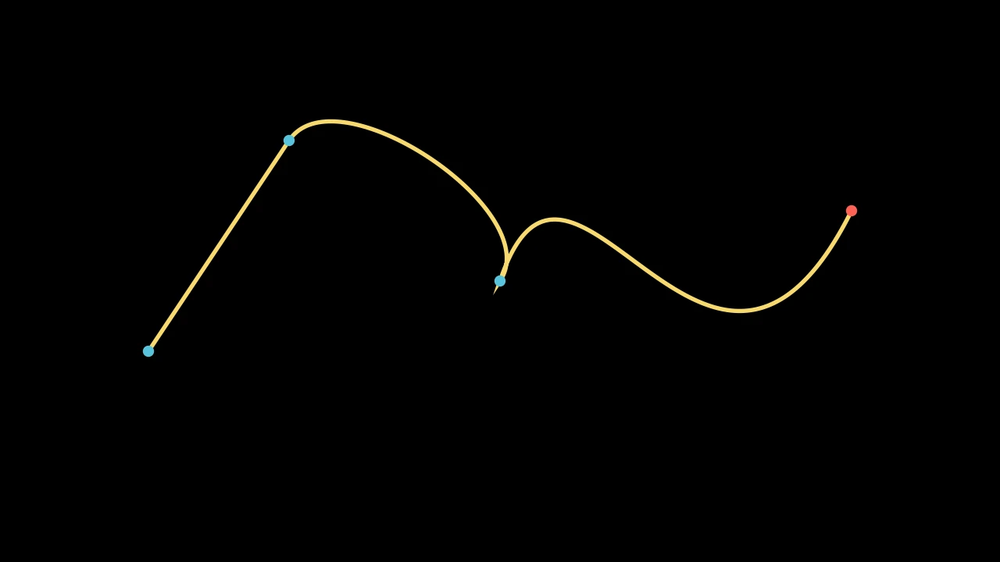

# 路径




```python fold title="影片代码"
import manimgx as m


class PathsHero(m.Scene):
    def construct(self) -> None:
        path = m.VMobject(color=m.YELLOW, stroke_width=6)
        path.start_new_path([-5, -1, 0])
        path.add_line_to([-3, 2, 0])
        path.add_smooth_curve_to([0, 0, 0])
        path.add_cubic_bezier_curve_to([1, 3, 0], [3, -3, 0], [5, 1, 0])
        anchors = m.VGroup(
            *[m.Dot(point, color=m.BLUE) for point in path.get_anchors()]
        )
        dot = m.Dot(color=m.RED).move_to(path.get_start())
        self.play(m.Create(path), run_time=2)
        self.play(m.FadeIn(anchors))
        self.play(m.MoveAlongPath(dot, path), run_time=2)
        self.wait()
```

形状就是路径：曲线，每条从一个点到下一个。曲线从锚点开始，
弯向两个控制点，在下一个锚点结束。描边沿曲线绘制，
填充将路径的每部分闭合回其起点。圆、多边形、文字和图
都是路径，因此这些操作对它们同样适用。

要绘制自定义路径，创建一个空的 `m.VMobject()`，然后给出其点：作为
角点、作为穿过它们的平滑曲线，或逐条添加线和曲线。

::: manimgx.VMobject
    options:
      heading_level: 2
      members: false

## 绘制路径

::: manimgx.VMobject.set_points_as_corners
    options:
      heading_level: 3

::: manimgx.VMobject.set_points_smoothly
    options:
      heading_level: 3

::: manimgx.VMobject.start_new_path
    options:
      heading_level: 3

::: manimgx.VMobject.add_line_to
    options:
      heading_level: 3

::: manimgx.VMobject.add_points_as_corners
    options:
      heading_level: 3

::: manimgx.VMobject.add_smooth_curve_to
    options:
      heading_level: 3

::: manimgx.VMobject.add_cubic_bezier_curve_to
    options:
      heading_level: 3

::: manimgx.VMobject.add_quadratic_bezier_curve_to
    options:
      heading_level: 3

::: manimgx.VMobject.add_cubic_bezier_curve
    options:
      heading_level: 3

::: manimgx.VMobject.add_cubic_bezier_curves
    options:
      heading_level: 3

::: manimgx.VMobject.add_subpath
    options:
      heading_level: 3

::: manimgx.VMobject.append_vectorized_mobject
    options:
      heading_level: 3

::: manimgx.VMobject.close_path
    options:
      heading_level: 3

::: manimgx.VMobject.is_closed
    options:
      heading_level: 3

## 平滑或锐利

::: manimgx.VMobject.make_smooth
    options:
      heading_level: 3

::: manimgx.VMobject.make_jagged
    options:
      heading_level: 3

::: manimgx.VMobject.insert_n_curves
    options:
      heading_level: 3

## 沿路径

::: manimgx.Mobject.get_start
    options:
      heading_level: 3

::: manimgx.Mobject.get_end
    options:
      heading_level: 3

::: manimgx.Mobject.get_midpoint
    options:
      heading_level: 3

::: manimgx.VMobject.point_from_proportion
    options:
      heading_level: 3

::: manimgx.VMobject.proportion_from_point
    options:
      heading_level: 3

::: manimgx.VMobject.get_arc_length
    options:
      heading_level: 3

::: manimgx.VMobject.get_subcurve
    options:
      heading_level: 3

## 方向

::: manimgx.VMobject.get_direction
    options:
      heading_level: 3

::: manimgx.VMobject.reverse_direction
    options:
      heading_level: 3

::: manimgx.VMobject.force_direction
    options:
      heading_level: 3

## 其点

::: manimgx.Mobject.points
    options:
      heading_level: 3

::: manimgx.Mobject.set_points
    options:
      heading_level: 3

::: manimgx.Mobject.reset_points
    options:
      heading_level: 3

::: manimgx.Mobject.has_points
    options:
      heading_level: 3

::: manimgx.VMobject.append_points
    options:
      heading_level: 3

::: manimgx.VMobject.get_anchors
    options:
      heading_level: 3

::: manimgx.VMobject.get_subpaths
    options:
      heading_level: 3

::: manimgx.VMobject.get_num_curves
    options:
      heading_level: 3

::: manimgx.bezier
    options:
      heading_level: 3

## 由路径构成的路径

::: manimgx.CubicBezier
    options:
      heading_level: 3

::: manimgx.DashedVMobject
    options:
      heading_level: 3

::: manimgx.CurvesAsSubmobjects
    options:
      heading_level: 3

::: manimgx.VectorizedPoint
    options:
      heading_level: 3