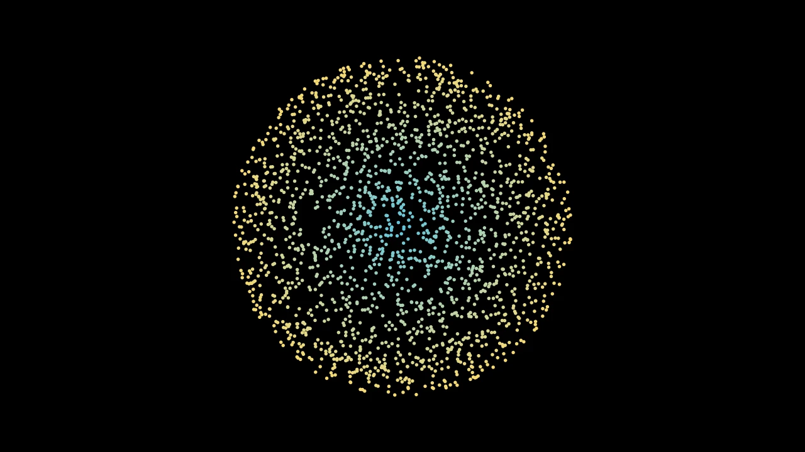

# 点云




```python fold title="影片代码"
import manimgx as m
import numpy as np


class PointCloudsHero(m.Scene):
    def construct(self) -> None:
        rng = np.random.default_rng(3)
        angles = rng.uniform(0, 2 * np.pi, 2000)
        radii = 3 * np.sqrt(rng.uniform(0, 1, 2000))
        points = np.stack(
            [radii * np.cos(angles), radii * np.sin(angles), np.zeros(2000)], axis=1
        )
        rgbas = np.array(
            [m.interpolate_color(m.BLUE, m.YELLOW, r / 3).to_rgba() for r in radii]
        )
        cloud = m.PMobject(stroke_width=6).add_points(points, rgbas)
        self.play(m.FadeIn(cloud))
        self.play(m.Rotate(cloud, m.PI / 2), run_time=2)
        self.wait()
```

点云是以点形式绘制的 mobject：每个点都是自身颜色的圆点，宽度为
点云的描边宽度。点云适合表示多而小的东西：尘埃、星星、样本。

::: manimgx.PMobject
    options:
      heading_level: 2

::: manimgx.PointCloudDot
    options:
      heading_level: 2