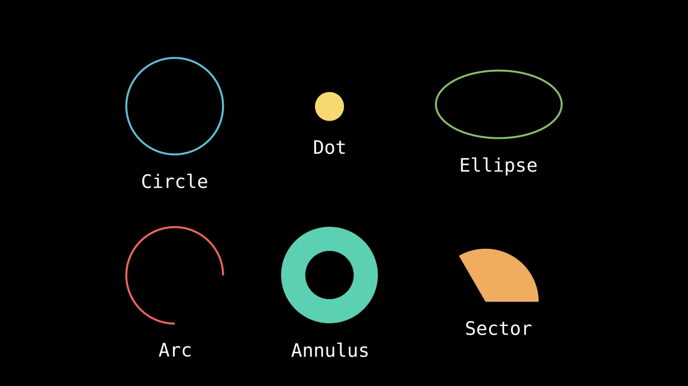
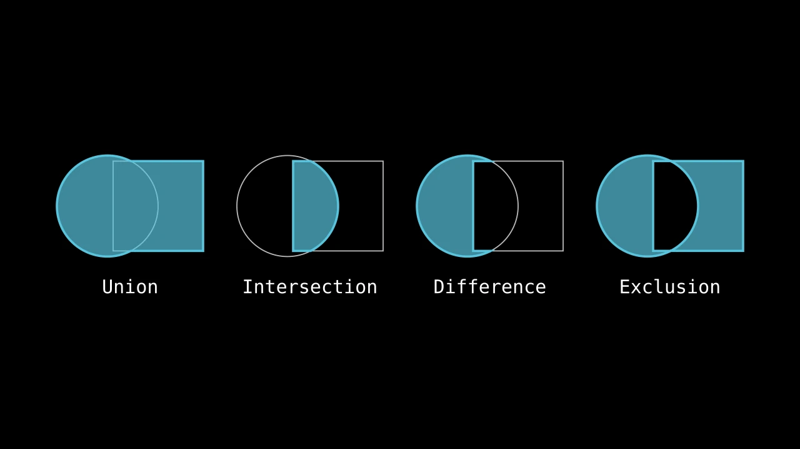

# 形状

形状就是路径：描边绘制、填充填充的曲线（参见 [Paths](../paths.md)）。
每种形状都是一个类：以其尺寸创建，然后像任何
mobject 一样放置和设置样式。

-   

    [**线和箭头**](lines-and-arrows.md)

    ---

    点之间的线、指示方向的箭头、向量，以及末端的箭头。

-   

    [**圆和弧**](circles-and-arcs.md)

    ---

    圆、圆点、椭圆和弧，以及由它们构成的环和扇形。

-   

    [**多边形**](polygons.md)

    ---

    直边形状，从三角形到星形，以及框住
    屏幕的矩形。

-   

    [**组合形状**](combining-shapes.md)

    ---

    形状与另一个的并、交或差、孔洞，以及凸包。

