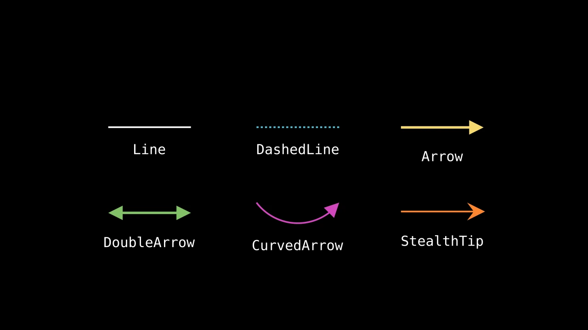

# 线和箭头




```python fold title="影片代码"
import manimgx as m


class LinesAndArrows(m.Scene):
    def construct(self) -> None:
        line = m.Line(m.LEFT, m.RIGHT)
        dashed = m.DashedLine(m.LEFT, m.RIGHT, color=m.BLUE)
        arrow = m.Arrow(m.LEFT, m.RIGHT, buff=0, color=m.YELLOW)
        double = m.DoubleArrow(m.LEFT, m.RIGHT, buff=0, color=m.GREEN)
        curved = m.CurvedArrow(m.LEFT, m.RIGHT, color=m.PINK)
        stealth = m.Line(m.LEFT, m.RIGHT, color=m.ORANGE).add_tip(
            tip_shape=m.StealthTip
        )
        shapes = m.VGroup(line, dashed, arrow, double, curved, stealth)
        names = m.VGroup(
            m.Text("Line", font="monospace", font_size=26),
            m.Text("DashedLine", font="monospace", font_size=26),
            m.Text("Arrow", font="monospace", font_size=26),
            m.Text("DoubleArrow", font="monospace", font_size=26),
            m.Text("CurvedArrow", font="monospace", font_size=26),
            m.Text("StealthTip", font="monospace", font_size=26),
        )
        cells = m.VGroup()
        for shape, name in zip(shapes, names, strict=True):
            name.next_to(shape, m.DOWN, buff=0.4)
            cells.add(m.VGroup(shape, name))
        cells.arrange_in_grid(rows=2, buff=(1.4, 1))
        self.play(m.LaggedStart(*[m.Create(shape) for shape in shapes], lag_ratio=0.2))
        self.play(m.FadeIn(names))
        self.wait()
```

线连接两个点。箭头是末端有箭头的线，指示方向；
向量是从原点出发的箭头。线、箭头和弧的任一端都可以有箭头，
形状可以是](#_2)列出的任一种。

线的端点也可以是 mobject：线从该 mobject 的边缘出发，
从而连接两个形状而不穿过它们。

::: manimgx.Line
    options:
      heading_level: 2

::: manimgx.DashedLine
    options:
      heading_level: 2

::: manimgx.Arrow
    options:
      heading_level: 2

::: manimgx.DoubleArrow
    options:
      heading_level: 2

::: manimgx.Vector
    options:
      heading_level: 2

::: manimgx.CurvedArrow
    options:
      heading_level: 2

::: manimgx.CurvedDoubleArrow
    options:
      heading_level: 2

::: manimgx.TangentLine
    options:
      heading_level: 2

## 箭头

箭头是线、弧或箭头末端的小形状。箭头自带箭头；任何
其他线或弧通过 `add_tip` 添加。`tip_shape` 选择其形状，`tip_style`
选择其样式。

::: manimgx.TipableVMobject
    options:
      heading_level: 3
      members: [add_tip, pop_tips, get_tip, get_tips, has_tip, has_start_tip, tip, start_tip, get_start, get_end, get_length]

::: manimgx.mobjects.shapes.TippedBase
    options:
      heading_level: 3
      inherited_members: [tip_length, normal_vector, tip_style]

### 箭头形状

::: manimgx.ArrowTriangleFilledTip
    options:
      heading_level: 4

::: manimgx.ArrowTriangleTip
    options:
      heading_level: 4

::: manimgx.StealthTip
    options:
      heading_level: 4

::: manimgx.ArrowCircleFilledTip
    options:
      heading_level: 4

::: manimgx.ArrowCircleTip
    options:
      heading_level: 4

::: manimgx.ArrowSquareFilledTip
    options:
      heading_level: 4

::: manimgx.ArrowSquareTip
    options:
      heading_level: 4

::: manimgx.ArrowTip
    options:
      heading_level: 4