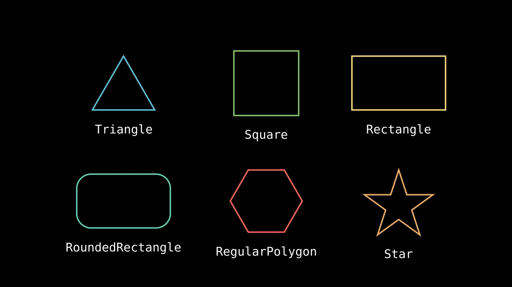

# 多边形




```python fold title="影片代码"
import manimgx as m


class PolygonsHero(m.Scene):
    def construct(self) -> None:
        shapes = m.VGroup(
            m.Triangle(color=m.BLUE),
            m.Square(side_length=1.8, color=m.GREEN),
            m.Rectangle(width=2.6, height=1.5, color=m.YELLOW),
            m.RoundedRectangle(width=2.6, height=1.5, corner_radius=0.4, color=m.TEAL),
            m.RegularPolygon(n=6, color=m.RED),
            m.Star(color=m.GOLD),
        )
        names = [
            "Triangle",
            "Square",
            "Rectangle",
            "RoundedRectangle",
            "RegularPolygon",
            "Star",
        ]
        cells = m.VGroup()
        for shape, name in zip(shapes, names, strict=True):
            label = m.Text(name, font="monospace", font_size=26)
            cells.add(m.VGroup(shape, label.next_to(shape, m.DOWN, buff=0.4)))
        cells.arrange_in_grid(rows=2, buff=(1, 0.8))
        self.play(m.LaggedStart(*[m.Create(cell[0]) for cell in cells], lag_ratio=0.15))
        self.play(m.FadeIn(m.VGroup(*[cell[1] for cell in cells])))
        self.wait()
```

多边形是直边形状，从每个角到下一个，从最后一个
回到第一个。给 `m.Polygon` 其角点，或使用现成的：三角形、正方形、
矩形、正多边形、星形。每个多边形都可以圆角化。

多边形组是一个形状中的多个多边形；多边形是单一多边形的多边形组。

::: manimgx.Polygon
    options:
      heading_level: 2

::: manimgx.Polygram
    options:
      heading_level: 2

::: manimgx.Triangle
    options:
      heading_level: 2

::: manimgx.Square
    options:
      heading_level: 2

::: manimgx.Rectangle
    options:
      heading_level: 2

::: manimgx.RoundedRectangle
    options:
      heading_level: 2

::: manimgx.RegularPolygon
    options:
      heading_level: 2

::: manimgx.RegularPolygram
    options:
      heading_level: 2

::: manimgx.Star
    options:
      heading_level: 2

::: manimgx.ArcPolygon
    options:
      heading_level: 2

::: manimgx.ArcPolygonFromArcs
    options:
      heading_level: 2

## 屏幕的形状

::: manimgx.ScreenRectangle
    options:
      heading_level: 3

::: manimgx.FullScreenRectangle
    options:
      heading_level: 3