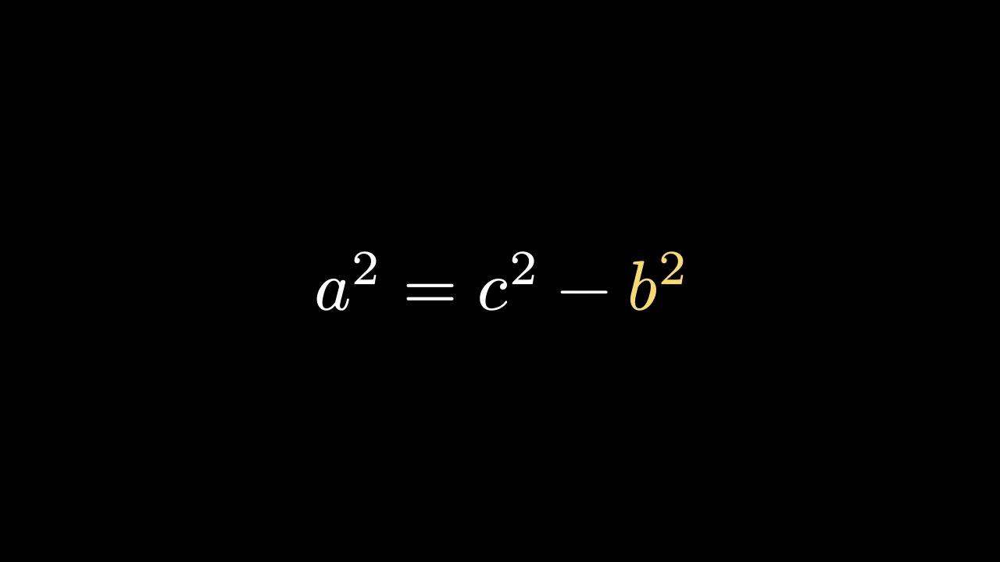

# 数学




```python fold title="影片代码"
import manimgx as m


class MathHero(m.Scene):
    def construct(self) -> None:
        before = m.MathTex("a^2", "+", "b^2", "=", "c^2", font_size=96)
        after = m.MathTex("a^2", "=", "c^2", "-", "b^2", font_size=96)
        before[2].set_color(m.YELLOW)
        after[4].set_color(m.YELLOW)
        self.play(m.Write(before))
        self.play(m.TransformMatchingTex(before, after))
        self.wait()
```

[MathTex][manimgx.MathTex] 排版 LaTeX 书写的公式：分数、根号、求和与
积分、矩阵、`cases`、希腊字母。用原始字符串 `r"..."` 书写，以便
Python 保留其反斜杠。LaTeX 宏包和 `\def` 不起作用；ManimGX 不认识的
命令会以其名称中止场景。

给 `MathTex` 多个字符串，每个都是公式的一部分，可以单独
着色、移动或动画化：`MathTex("a^2", "+", "b^2")[2]` 是 b²。在两个公式中
书写相同的部分会通过
[TransformMatchingTex][manimgx.TransformMatchingTex] 相互变换。

[Tex][manimgx.Tex] 是含公式的文字，公式在 `$` 符号之间。如果你了解
Typst，直接书写：[Typst][manimgx.Typst] 接受 Typst 标记，
[MathTypst][manimgx.MathTypst] 接受 Typst 数学语法的公式。

::: manimgx.MathTex
    options:
      heading_level: 2

::: manimgx.MathTexPart
    options:
      heading_level: 2

::: manimgx.Tex
    options:
      heading_level: 2

::: manimgx.Typst
    options:
      heading_level: 2

::: manimgx.MathTypst
    options:
      heading_level: 2

## 排版文字的组成部分

每个文字和公式都由 Typst 排版出的字形组成：每个字形知道其
源中的哪些字符。Typst 无法排版的源会以 Typst 的错误中止场景。

::: manimgx.mobjects.text.TypstGlyph
    options:
      heading_level: 3

::: manimgx.drawing.typesetting.TypstError
    options:
      heading_level: 3