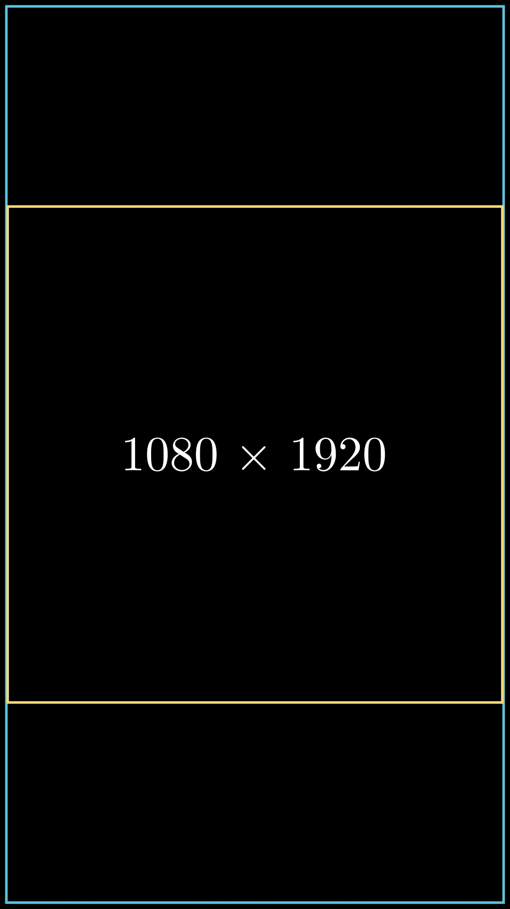

# 配置




```python fold title="影片代码"
import manimgx as m

m.config.pixel_width, m.config.pixel_height = 1080, 1920


class ConfigurationHero(m.Scene):
    def construct(self) -> None:
        frame = m.Rectangle(
            width=m.config.frame_width - 0.2,
            height=m.config.frame_height - 0.2,
            color=m.BLUE,
        )
        square = m.Square(side_length=8, color=m.YELLOW).scale(0.97)
        label = m.Text("1080 × 1920", font_size=56)
        self.play(m.Create(frame), m.Create(square), m.Write(label))
        self.wait()
```

`m.config` 保存每个场景创建时使用的内容：视频的像素大小、帧率、
背景，以及画面以单位计的大小。在 `import manimgx as m` 之后、
创建场景之前设置它；命令行选项也会设置它（`-r 1080x1920`、`--fps 30`）。

画面具有视频的形状，其短边为 8 个单位：宽屏视频显示约
14.2 × 8 个单位，竖屏约 8 × 14.2，中间的 8 × 8 正方形在两者中都有。

::: manimgx.config.config
    options:
      heading_level: 2

::: manimgx.config.Config
    options:
      heading_level: 2