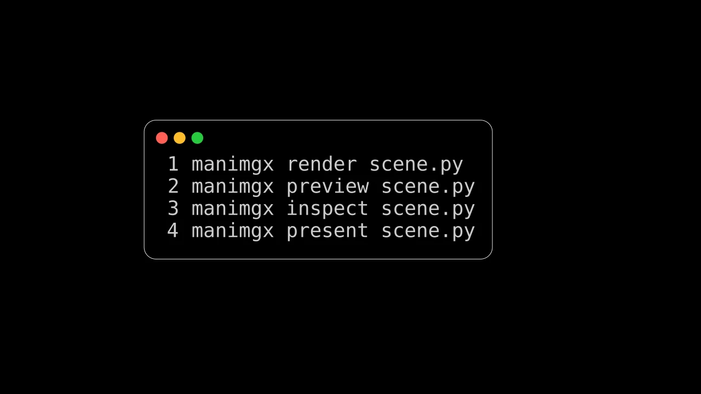
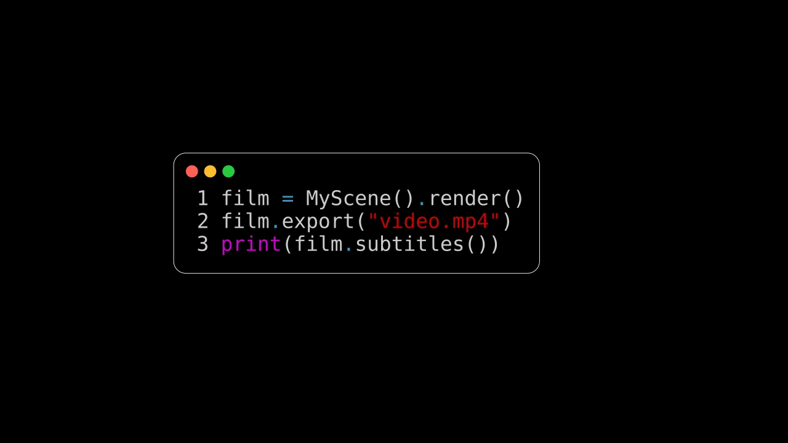

# 渲染




```python fold title="影片代码"
import manimgx as m


class RenderingHero(m.Scene):
    def construct(self) -> None:
        commands = m.Code(
            code_string="manimgx render scene.py\nmanimgx preview scene.py\nmanimgx inspect scene.py\nmanimgx present scene.py",
            language="bash",
            background="window",
        ).scale(1.2)
        self.play(m.FadeIn(commands))
        self.wait()
```

`manimgx` 命令制作场景的视频，一个 MP4 文件，位于场景文件旁。
它还在编辑时在窗口中播放场景、检查观众会看到的问题、绘制静帧，
以及以幻灯片形式展示。配置设置视频的大小、帧
率和背景。从 Python，场景渲染为影片，程序可以保留、
在窗口中播放或写入。

<div class="grid cards mx-cards" markdown>

-   

    [**命令行**](command-line.md)

    ---

    `manimgx render`、`preview`、`inspect` 和 `present`，及其选项。

-   

    [**配置**](configuration.md)

    ---

    视频的大小和帧率、背景，以及画面以单位计的大小。

-   

    [**从 Python**](from-python.md)

    ---

    从程序渲染场景：其影片、帧、声音和字幕。

</div>