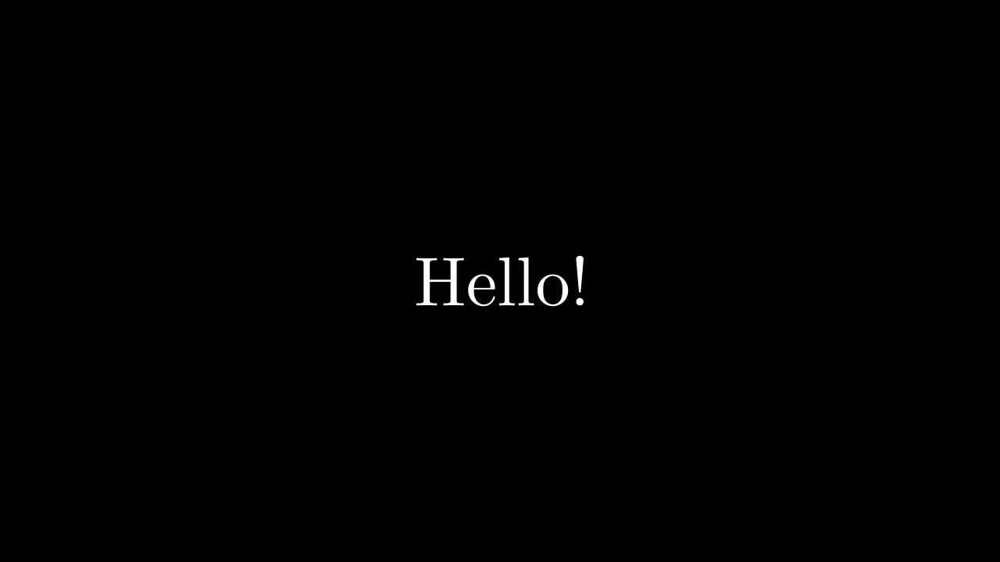

# 场景




```python fold title="影片代码"
import manimgx as m


class ScenesHero(m.Scene):
    def construct(self) -> None:
        circle = m.Circle(color=m.BLUE, fill_opacity=0.5)
        words = m.Text("Hello!", font_size=72)
        self.play(m.Create(circle))
        self.play(m.FadeOut(circle))
        self.play(m.Write(words))
        self.wait()
```

场景就是一个视频。从 [Scene][manimgx.Scene] 创建一个类，在其
`construct` 方法中书写发生的事情：ManimGX 从上到下运行它，每一行
按顺序添加到视频中。类的名称就是视频的名称：场景 `Hello` 生成
`Hello.mp4`。

时间只在 [play][manimgx.Scene.play] 和 [wait][manimgx.Scene.wait] 中流逝。一个 play 在
前一个结束时开始，持续其最长动画的时长；wait 保持
画面不动，同时更新器继续运行。[add][manimgx.Scene.add] 立即显示 mobject，
不占用时间。

<div class="grid cards mx-cards" markdown>

-   

    [**Scene**](scene.md)

    ---

    发生什么以及何时：播放和等待、场景显示的内容、其分段和影片。

-   <video src="../../films/ThreeDScenesHero.mp4" autoplay loop muted playsinline controls></video>

    [**3D 场景**](../camera-and-3d/three-d-scenes.md)

    ---

    三维空间中观察的场景，由围绕其旋转的相机呈现。

-   

    [**现成场景**](ready-made-scenes.md)

    ---

    为向量、平面的线性变换和缩放插图制作的场景。

</div>