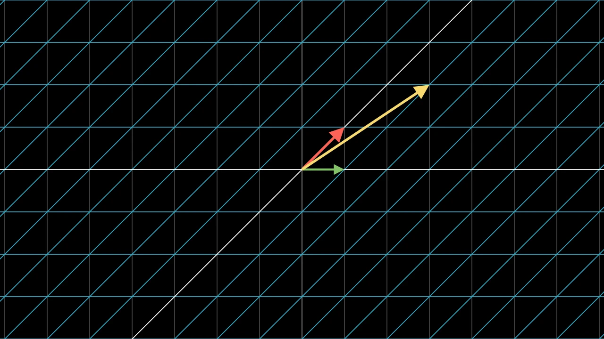

# 现成场景




```python fold title="影片代码"
import manimgx as m


class ReadyMadeScenesHero(m.LinearTransformationScene):
    def construct(self) -> None:
        self.add_vector([1, 2], color=m.YELLOW)
        self.apply_matrix([[1, 1], [0, 1]])
        self.wait()
```

这些场景自带某类视频所需的内容。向量场景从平面
原点绘制向量，附带标签和坐标。线性变换场景
在一次播放中将矩阵作用于平面及其上的所有内容。缩放场景
在插图中显示画面的放大部分。

::: manimgx.VectorScene
    options:
      heading_level: 2

::: manimgx.LinearTransformationScene
    options:
      heading_level: 2

::: manimgx.ZoomedScene
    options:
      heading_level: 2

::: manimgx.scene.ZoomedCameraConfig
    options:
      heading_level: 3